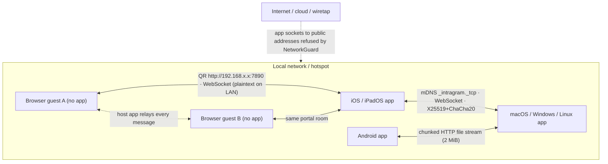

<div align="center">

# IntraGram

**No cloud. No accounts. Local network only.**


-critical?style=flat-square)


**[English](#english) · [한국어](#한국어)**

</div>

---

<a name="english"></a>

## English

IntraGram is a peer-to-peer messenger for people on the same Wi-Fi or LAN. No cloud service, no account. The app's own traffic only goes to private addresses on your network (the [Security model](#security-model) says what that does and does not cover), and by default no chat is written to disk. The name joins *intranet* and *-gram* (something written). IntraGram is not affiliated with Instagram, Telegram or Meta.

| Local network only | Zero-Disk, RAM only | X25519 E2EE (1:1) |
| :--- | :--- | :--- |
| No cloud service, no account, no internet needed. Every socket the app opens is checked against private (RFC 1918), link-local and IPv6 unique local ranges and refused otherwise. | Messages, keys and transfer records live in memory only. Quit the app or hit **Panic wipe** and they are gone. | App-to-app links use an ephemeral X25519 key agreement and ChaCha20-Poly1305, so a 1:1 chat is end-to-end encrypted. Compare a 6-digit code out loud to catch a man in the middle. Group rooms are encrypted hop by hop through the host. |

**Contents:** [Status](#status) · [Features](#features) · [Why](#why-intragram) · [Install](#install) · [Troubleshooting](#troubleshooting) · [Build from source](#build-from-source) · [Security model](#security-model) · [Architecture](#architecture) · [Development](#development) · [Contributing](#contributing) · [Credits](#credits) · [License](#license)

### Status

Release candidate. The code targets six platforms, but none has completed real-device QA and nothing has had an independent security audit. A platform that has not passed [DEVICE_QA.md](DEVICE_QA.md) is not a supported release.

| Platform | Build | Signing | Real-device QA |
| :--- | :--- | :--- | :--- |
| Android | APK per ABI | no release key yet, so no APK is published | not run |
| iOS / iPadOS | IPA (iPad: list and chat side by side from 840 pt wide, not checked on a device) | unsigned | not run |
| macOS | universal app | ad-hoc, not notarized | not run |
| Windows x64 | release workflow written, not run yet | none | not run |
| Linux x64 | release workflow written, not run yet; behavior and dependencies not reviewed | none | not run |
| Browser guest | page served by the host app | n/a | not run (desktop Chrome, Firefox, Safari, Edge; iOS Safari; Android Chrome) |

Automated checks: static analysis (0 issues), 700+ unit, widget and integration tests, a browser-client guard, and large-transfer regressions (64 and 256 MiB by default, also run at 1 and 4 GiB). They do not replace testing on real devices and a real Wi-Fi network.

After the repository opens publicly, report bugs and questions in **Issues** with your OS and device, app version and steps to reproduce. Strip message contents, IP addresses, keys, tokens and PINs from logs and screenshots. Report vulnerabilities privately, as described in [SECURITY.md](SECURITY.md).

### Features

- **Ephemeral by default.** Conversations live in the process heap: no SQLite, no `SharedPreferences`, no cache files of its own. Flutter and the OS still keep their usual caches (shader cache, window position, the app switcher snapshot, which iOS covers and Android blocks), none of which holds chat content. On desktop, picking a download folder records its path so a crash's half-received files can be cleaned up; Panic wipe removes that list. Quit or **Panic wipe** drops them at once and overwrites the buffers the app owns (session and vault keys, frame plaintext, file chunks, voice audio). Message strings and the crypto library's own key copies can only be released, not overwritten (see [SECURITY.md](SECURITY.md)).
- **Burn timer.** Pick 5, 30 or 60 s. The countdown starts when the other side *reads* the message and runs on both screens. A read receipt or burn that cannot reach a device that is asleep or offline goes out when the two reconnect; if they never do, the sender's copy burns 24 h after sending. Unread messages burn after 24 h.
- **Opt-in vault.** *Settings › Keep chats on this device* saves the scopes you pick (messages, transfer history) to one JSON file in the app folder, optionally sealed with a PIN (PBKDF2 + ChaCha20-Poly1305). Panic wipe erases it, and a message the peer deletes disappears from it. Rooms are never saved. A short PIN only slows down someone who copies the file.
- **Files, no size cap.** Multi-file and folder batches stream in 2 MiB chunks, so the limit is the receiver's free disk, never RAM. Accept, decline, cancel and retry per transfer; drag and drop on desktop; one-tap clipboard send. In 1:1 chats the bytes are sealed with ChaCha20-Poly1305 under a sub-key derived from the session key. In a group room they go directly between devices, unencrypted; the offer, which travels over the encrypted links, carries the file's SHA-256, so a receiving app deletes bytes that were changed on the way. The sender reads the file once to hash it, so a very large file reaches the room a little later.
- **Where received files go.** On desktop, to the folder you pick on the first accept. On iPhone and iPad, to *Files › On My iPhone › IntraGram*. On Android, to the app's private folder, which file managers cannot see, so use **Share or save** on the file to keep it in Downloads, Drive or another app.
- **Group rooms.** One app is the LAN hub. App peers join from the *On this network* list (*Add to my room*) or from a 1:1 chat (*Add people*). Anyone without the app joins from a browser by scanning the **Guest portal** QR. The web client is one self-contained HTML page served by the app, with no external script, font or image, and it only talks to the host that served it. A room is encrypted hop by hop, not end to end: the host decrypts every message to relay it, and a banner at the top of the room says so.
- **What a browser guest gets.** Text, a 👍 on a message (double-click, or Enter on a focused message), the self-destruct timer, voice playback, and files, several of them sent one at a time. A guest cannot quote-reply or pick other reactions, the files it sends reach only the host, and a file it downloads is held in the browser's memory until it is saved, so a very large file can fail on a phone (the app-to-app "free disk, not RAM" limit does not apply). A page served over plain `http` on the LAN cannot show notifications, so the tab title counts new messages instead.
- **Connect by IP.** For Wi-Fi that blocks mDNS multicast: enter `192.168.x.x` and a port.
- **The chat basics.** Replies, reactions, typing and read indicators, delete for everyone, search (in RAM, kept across restarts if the vault is on), and local notifications on Android, macOS and Linux while the app is in the background and still connected. Windows shows no system notifications yet. There is no server to wake a fully closed app.
- **iPhone and iPad stay connected only while the app is open.** iOS pauses an app a few seconds after you leave it, so its links drop and its notifications stop; open IntraGram again and the other side can reconnect. The photo picker sends photos only (up to 10 at a time, 50 MB in all); send videos from the Files app. Drag and drop works on desktop, not on iPad.
- **Block and filter.** Block a device from a 1:1 chat's menu. Device IDs change at each launch, so a block lasts until one of you restarts IntraGram; *Settings › Only chats I start* refuses chats and room invites from any device you have not talked to since launch.
- **Desktop and iPad keyboards.** On a window at least 840 pt wide the chat list stays next to the open chat. Cmd/Ctrl+F searches, Cmd/Ctrl+, opens Settings, Cmd/Ctrl+N connects by IP, Cmd/Ctrl+O sends a file in a chat, Esc or Cmd/Ctrl+W closes the current screen, and Ctrl+Tab moves to the next chat. On macOS the same commands are in the menu bar.
- **English and Korean.** Follows the device language, or pin it in Settings. A Korean-locale browser gets the Korean portal.

### Why IntraGram

A message to a colleague two meters away usually travels through a data center on another continent and stays there. [LocalSend](https://github.com/localsend/localsend) fixed that for files: same Wi-Fi, no cloud, no account. But it moves files and one-off texts, not conversations, and a received file stays on disk. (IntraGram does not talk to LocalSend apps; discovery and protocol differ.) IntraGram brings the same idea to conversation (messages, typing, read receipts, files, a burn timer) with nothing left to leak: no account, no history, no server. Close the lid and the room is gone.

| | AirDrop | Telegram | LocalSend | **IntraGram** |
| :--- | :---: | :---: | :---: | :---: |
| Works with no internet | ✅ | ❌ | ✅ | ✅ |
| Leaves a permanent record | no (transient) | **yes, cloud chats live on its servers** (secret chats aside) | received files stay on disk | **no by default; opt-in vault; only files you accept are written** |
| Real conversation (typing, read, reactions, reply, burn timer) | ❌ | ✅ | ❌ one-off texts, no chat | ✅ |
| Group chat | ❌ | ✅ via the cloud | ❌ | ✅ **one device is the LAN hub, no cloud** |
| Platforms | Apple (and Pixel 10 through Quick Share since late 2025) | all | all | iOS, iPadOS, Android, macOS, Windows, Linux **+ browser guests** (see [Status](#status)) |
| Needs an account or phone number | ❌ | ✅ | ❌ | ❌ |

Closer relatives: [Briar](https://briarproject.org/) and Bitchat also chat without servers or accounts, over Bluetooth, Wi-Fi or Tor, and Quick Share moves files between nearby Android and Windows devices. IntraGram sits between them: every major OS plus a browser, so a mixed group joins one room from a QR code without installing anything, but it needs a shared LAN or hotspot and has no mesh relay.

It fits places where the internet is blocked, slow or not wanted: an internal network with no outside access, a factory floor, a ship or a test site, a classroom or lab with mixed laptops and phones, or a meetup where a few people need a room for an hour and nobody wants to trade phone numbers.

### Install

**Phones have no signed or store build yet.** Android has no release key, so no APK is published, and the iOS `.ipa` is unsigned. Until that changes, the quickest way to try IntraGram is a desktop build, with phones joining from the browser through the **Guest portal**, or building from source.

Download a build from **Releases** and check it against the attached `SHA256SUMS.txt`, which lists every platform's files (`shasum -a 256 -c --ignore-missing SHA256SUMS.txt` on macOS, `sha256sum -c --ignore-missing SHA256SUMS.txt` on Linux, and on Windows compare `Get-FileHash <file> -Algorithm SHA256` in PowerShell with its line). The checksums sit on the same release page as the files, so they catch a broken download, not a tampered release; the release workflow also publishes a build provenance attestation, which `gh attestation verify <file> --repo <owner>/IntraGram` checks against the workflow that built it. Each platform's measured signing state is in the attached `SIGNING-<platform>.txt`. IntraGram only listens on and dials private LAN addresses, so allow firewall prompts for **private** networks only.

- **Android**: a release APK is attached only when it is signed with the project's release key, and there is none yet. Once there is, allow "install unknown apps" for your file manager (turn it off again afterwards) or use `adb install`, and pick `arm64-v8a` for any recent phone.
- **iOS / iPadOS**: the `.ipa` is unsigned. Sideload it with AltStore or Sideloadly (both sign with your Apple ID; a free account's signature expires after 7 days), or build from source in Xcode with your own team.
- **macOS**: ad-hoc signed and not notarized, so Gatekeeper blocks the first launch. On macOS 15 and later, open the app once, then go to *System Settings › Privacy & Security* and click **Open Anyway**. On macOS 12 to 14, right-click the app and choose Open. Only after the checksum matches, `xattr -dr com.apple.quarantine IntraGram.app` (on this app only) also works. Allow the Local Network prompt.
- **Windows**: unzip the whole folder and run `intragram.exe`. SmartScreen warns about an unsigned app ("More info", then "Run anyway"). On a PC with Smart App Control turned on, Windows blocks unsigned apps outright and has no per-app exception, so IntraGram will not run there until it is signed. Allow the Windows Firewall prompt for private networks.
- **Linux**: extract the tarball and run `./intragram`; `./install.sh` adds it to your app menu with its icon (`./install.sh --uninstall` removes it, and run it again if you move the folder). You also need `libgtk-3`, `pulseaudio-utils` (voice messages: `parecord` records and `pacat` plays; PipeWire systems need `pipewire-pulse`), `avahi-daemon` (discovery) and `xdg-desktop-portal` with a backend such as `xdg-desktop-portal-gtk`, `-gnome` or `-kde` (file dialogs). `xdg-utils` lets the app open received files and their folder. Package names vary by distribution.

If you turn on the vault, its `vault.json` and `identity.json` live in the app's Application Support/IntraGram directory, separate from received files in `Documents/IntraGram`. On iOS the app requests backup exclusion and complete file protection for private storage; check both on a device before release. Received files remain visible in Files and may be backed up. macOS backups may include the vault. Android's OS backup and device transfer of app data are disabled.

### Troubleshooting

- **The other device does not show up.** Both devices must be on the same Wi-Fi. Guest networks and most office, school and café Wi-Fi keep devices apart (AP isolation); turn on a phone hotspot and join it with both devices. You can also use **Connect by IP** with the address on the other device's home screen, or scan its device code.
- **"This Wi-Fi can't be used for IntraGram".** The network gave the device a public or carrier (`100.64.x.x`) address, and IntraGram only talks over private addresses. Use a phone hotspot.
- **iPhone, iPad or Mac finds nothing.** Turn on Local Network access for IntraGram: on iOS and iPadOS in *Settings › IntraGram*, on macOS in *System Settings › Privacy & Security › Local Network*.
- **Windows or Linux finds nothing, or nobody can connect to it.** Allow IntraGram through Windows Firewall on private networks and make sure the Wi-Fi is set to a private network, or open the port shown on the home screen in `ufw` or `firewalld`.
- **A VPN is on.** Many VPN apps route the local network through the tunnel or block it. Turn on the VPN's local-network option, or switch the VPN off while chatting.
- **The browser page says the address has no entry code, or that the portal is off.** Open the full address from the app's **Guest portal** (it ends in `#t=…`) or scan the QR code again. A reload keeps you in within the same tab, but turning the portal off (or on again, which makes a new code) sends every guest back to the QR code.
- **Microphone or camera access was denied.** Tap **Open Settings** in the app's notice, or turn it on in the system settings.

### Build from source

Requires Flutter 3.44 (stable).

```bash
flutter pub get
flutter run     # pick a device, then start IntraGram on a second device on the same Wi-Fi
```

Release builds:

| OS | Command | Output |
| :--- | :--- | :--- |
| Android | `flutter build apk --release --split-per-abi` | `build/app/outputs/flutter-apk/` |
| iOS / iPadOS | `flutter build ios --release` (needs signing) | Xcode archive |
| macOS | `flutter build macos --release` | `build/macos/Build/Products/Release/` |
| Windows | `flutter build windows --release` | `build/windows/x64/runner/Release/` (portable) |
| Linux | `flutter build linux --release` | `build/linux/x64/release/bundle/` |

Signing, store uploads and the release workflow are in [RELEASING.md](RELEASING.md).

**Guests without the app.** Open **Guest portal** (QR icon, top right) and scan the code with a phone camera, or open the full address shown under it. That address ends in `#t=…`, an entry code that works for every guest until you turn the portal off (turning it on again makes a new one), so typing just `http://<host-ip>:7890` will not get in, and the port moves up from 7890 when that one is taken. Up to 32 guests can share one room, and the host app is the hub, so nobody has to install anything. Guest traffic is plaintext **on the local link only**, because a browser cannot run the app's X25519 handshake. The page the host app serves is the only web path: opening IntraGram from a page on a public domain is out of scope for v1.0, and the server grants no cross-origin access and rejects WebSockets from other origins.

### Security model

- **Handshake and verification.** Every app-to-app link runs an X25519 key agreement and derives a 6-digit Short Authentication String (SAS). Both screens show the same digits unless someone is relaying the handshake, so read them out loud. Until you do, the chat wears a yellow *unverified* badge and verified-only features such as file auto-accept stay locked. When the same device reconnects while both apps are still running (a Wi-Fi drop), the new link has to prove the same identity key, so a code you already confirmed stays confirmed and only the digits change; after either app restarts it has a new identity key, so compare again.
- **Proven peer IDs.** A peer ID is the hash of an Ed25519 key generated at each launch (RAM only, never saved; Panic wipe replaces it), and both sides sign the handshake with it. Another LAN device can read an ID from mDNS, but it cannot rejoin a room as that member, receive that member's file offers or answer an invite meant for it. A peer that has not proven its ID gets no messages, cannot take over a chat you opened and cannot be put into a room.
- **Handshake limits.** One LAN device can hold 4 unfinished handshakes (16 overall) and connect at most 24 times per 10 seconds (96 overall), so idle sockets cannot lock everyone else out.
- **1:1 chats and group rooms.** A 1:1 chat is end-to-end encrypted: the link runs directly between the two apps and only they hold its keys. A group room is hop-by-hop: each member's link to the host is encrypted and has its own 6-digit code, but the host decrypts every message to relay it, members never compare codes with each other, and files go directly between devices unencrypted. A banner at the top of every room says so.
- **What it does not cover.** The host of a group room can read the whole room, and files sent in a room cross the LAN unencrypted (see above). Browser guests cannot run the handshake, so their traffic is plaintext on the local link. The shown name and platform are self-declared, and a first contact is only as trustworthy as the code you compare. The app itself fetches nothing, but a link you tap opens in your browser once you confirm the real address (shown in punycode when it mixes alphabets), and a received file you open is handed to another app (a web page or shortcut can then reach the internet; the app asks first for those types). The QR scanner decodes camera frames on the device with a pure-Dart port of ZXing and has no network component.

Full threat model and reporting policy: [SECURITY.md](SECURITY.md). What the app keeps and sends: [PRIVACY.md](PRIVACY.md). Nothing here has had an independent audit.

### Architecture



| Layer | File(s) | Role |
| :--- | :--- | :--- |
| Private-address guard | `lib/core/network_guard.dart` | RFC 1918 classification, guarded socket dial, WAN drop |
| Path safety | `lib/core/path_safety.dart` | Sanitizes a peer-supplied filename, then proves the write stays in the folder |
| In-memory store | `lib/store/in_memory_store.dart` | RAM-only message and transfer queues, burn timers, secure wipe |
| Local vault (opt-in) | `lib/store/vault.dart` | Off by default; a JSON snapshot of the scopes you chose (optionally PIN-sealed), kept in sync with deletes |
| Crypto | `lib/network/crypto_engine.dart` (+ `sas_generator.dart`, `peer_auth.dart`) | Ephemeral X25519 + HKDF-SHA256 + ChaCha20-Poly1305, 6-digit SAS, per-launch Ed25519 identity proof |
| Discovery | `lib/network/discovery_engine.dart` | `bonsoir` mDNS broadcast and scan |
| Embedded server | `lib/network/local_server.dart` (+ `server_routes.dart`) | `shelf` HTTP / WebSocket; serves the web client and file endpoints |
| Peer link | `lib/network/peer_link.dart` (+ inbound / outbound parts) | One WebSocket + crypto session, frame routing |
| Link registry | `lib/network/link_registry.dart` | Owns every live link; 1:1 chats and host-relay group rooms |
| Transfers | `lib/network/registry/{outgoing,incoming}_transfers.dart` | Offer, accept, 2 MiB chunk streaming |
| Transfer I/O | `lib/network/file_streamer.dart` | Chunked send and receive, rate and ETA |
| UI | `lib/features/**` | Chat, burn timer, QR portal |

**Wire protocol v7.** `kProtocolVersion` (`lib/core/constants.dart`, mirrored by `PROTOCOL_VERSION` in `assets/web/js/socket.js`) is a hard gate: a `hello` or `web_hello` with any other version is refused at the handshake. Update every app together and reload any open browser guest. `test/protocol_version_test.dart` pins this.

- **v7** commits the dialer to its ephemeral key before the listener answers. The dialer's `hello` carries only `cmt`, a SHA-256 over its ephemeral X25519 key and its identity key; the listener replies with its own ephemeral key and a signature over that commitment, and only then does the dialer reveal its key in `auth`, which the listener checks against `cmt` (`lib/network/peer_auth.dart`). Neither side can pick a key after seeing the other's, so a relay cannot steer both screens to the same 6-digit code. All it can do is abort and redial until a code happens to match, about a million tries on average, which the inbound admission limits stretch to more than a day. Encrypted frames also carry a strict sequence: the nonce must equal the sequence number, and a genuine frame that skips a number (someone dropped one in between) ends the link instead of passing quietly. A room's `file_offer` may carry `dg`, the base64 SHA-256 of the unencrypted file, which the receiving app checks after the pull; older v7 apps ignore it.
- **v6** adds `file_unavailable`. When a room host cannot hand a member's file offer to the recipient it names (the recipient left, is shutting down, or the write failed), it tells the sender instead of leaving that recipient `offered` forever. Only the room's confirmed host may send it.
- **v5** makes peer IDs verifiable. The ID is the first 16 bytes of the SHA-256 of a per-launch Ed25519 public key (`idk` in `hello`). The listener signs its `hello` (`sig`) and the dialer answers with an `auth` frame. Both signatures cover the version, the role, both ephemeral X25519 keys and both identity keys (`lib/network/peer_auth.dart`), so a proof cannot be replayed on another session, reused in the other role or aimed at another peer.
- **v4** adds the room roster (`peers` in `room_join` / `room_state`) and per-recipient file offers (`file_offer.to`, routed by `lib/network/link_registry/room_file_routing.dart`).

#### Design rules

1. **Zero-disk by default.** No SQLite, Hive, `SharedPreferences` or `LocalStorage` anywhere in the tree. Message text has to pass through Dart `String`s, which a copying GC will not let us scrub, so the reference is dropped the moment a message burns or the session is wiped, and no copy is kept. Byte buffers the app owns (frame plaintext, file chunks, voice audio) are overwritten zero, random, zero when done, and session and vault keys sit in app-owned buffers that are zeroed on destroy. Copies the crypto library makes on its own (the X25519 private key, HKDF intermediates) are only released. Only two disk writes are intended: a file **you** accept into a folder **you** chose (on desktop that folder is also noted in `download_directories.json`, as a sandbox bookmark on macOS, so a half-received file can be deleted after a crash), and the opt-in vault **you** turn on.
2. **Private addresses only.** `NetworkGuard` classifies every address. The server binds to a private IPv4 address (on a network with no IPv4 LAN, to an IPv6 unique local address), and every outbound socket throws `SecurityException` unless the target is in `10/8`, `172.16/12`, `192.168/16`, loopback, `169.254/16`, `::1` or `fc00::/7`. Dialing a peer is stricter: `NetworkGuard.parsePeerEndpoint` accepts only canonical dotted-decimal RFC 1918 IPv4 (no loopback, no APIPA, no leading-zero, octal or hex forms). Loopback and APIPA stay only for internal uses that peer input cannot reach (tests). This checks the destination of the app's own sockets; it is not a packet filter and not an air gap. The Wi-Fi itself is usually online, a VPN or overlay that hands out private addresses (a company VPN, WireGuard, Tailscale, ZeroTier) carries the traffic across the internet inside its tunnel, a link you tap opens in your browser, and a received file you open is handed to another app.
3. **One codebase, every platform.** iOS, iPadOS, Android, macOS, Windows and Linux from a single Flutter codebase, plus a responsive browser client served by the embedded server.

### Development

```bash
dart format .                       # 80 columns, trailing commas
python3 tool/check_loc.py           # every first-party .dart file stays at 250 lines or fewer
flutter analyze                     # must stay at 0 issues
flutter test --exclude-tags large   # fast suite
node tool/browser_guard_test.js     # LAN-address guard and guest page behaviour in the web client
node tool/web_design_test.js        # guest page branding, contrast and layout contracts
git diff --check                    # no whitespace errors
flutter test --tags large           # 64 / 256 MiB streaming and RSS regression (slow)
```

For 1 and 4 GiB add `--dart-define=LARGE_SIZES_MIB=1024,4096`. CI runs everything except the `large` suite on every push and pull request, and builds each native platform when its folder or `pubspec` changes.

`test/` has one file per concern:

| Area | Tests |
| :--- | :--- |
| Private-address and path safety | `network_guard_test`, `path_safety_test` |
| Crypto and identity | `crypto_engine_test`, `sas_generator_test`, `peer_auth_weak_key_test`, `peer_link_identity_*_test` |
| Wire protocol | `protocol_*_test` (including `protocol_version_test`), `handshake_e2ee_*_test` |
| File transfer | `file_transfer_*_test`, `file_chunks_test`, `large_transfer_test` (tag `large`) |
| Group rooms | `member_room_*_test`, `portal_relay_*_test` |
| Link admission | `link_registry_pre_proof_test`, `link_registry_pending_cap_test`, `link_registry_admission_test` |
| Vault and wipe | `vault_*_test`, `panic_wipe_test`, `panic_identity_test` |
| Native config | `android_manifest_test` (Auto Backup stays off), `macos_release_entitlements_test` (no `get-task-allow` in Release) |
| UI | `test/ui/` (widget tests, one file per screen) |

### Contributing

PRs are welcome. The codebase is small on purpose: no code generation, and each file is meant to be read top to bottom in one sitting. Good first issues: more file-kind icons, better transfer stats, a Windows Explorer polish pass, tests for link-teardown races.

Rules for every pull request:

- `flutter analyze` stays at 0 issues, all tests stay green, `dart format` is clean, and no first-party `.dart` file exceeds 250 lines (`tool/check_loc.py`).
- **Zero-disk.** No SQLite, Hive, `SharedPreferences` or `LocalStorage`. The only disk writes are a file the user accepted (plus, on desktop, a note of its folder for cleanup after a crash) and the opt-in vault.
- **LAN only.** Every socket dial goes through `NetworkGuard`. A change that skips it is out of scope.
- **Wire changes bump the protocol.** Move `kProtocolVersion` and `PROTOCOL_VERSION` in `assets/web/js/socket.js` together. A new broadcast-style frame needs an entry in the `relayable` set (`lib/network/link_registry/room.dart`) before a room host forwards it; `file_*` frames are routed per transfer instead (`room_file_routing.dart`).
- **Strings and state.** User-facing strings go through `s.t('key')` in `lib/l10n/` (English and Korean). State models are immutable (`copyWith`).
- **Dependencies.** Do not add a package for what a few lines can do.

Signing material never goes in the repository; see [RELEASING.md](RELEASING.md). Contributions are accepted under the MIT License. [CONTRIBUTING.md](CONTRIBUTING.md) has the setup and the full pull request checklist, [CHANGELOG.md](CHANGELOG.md) what changed, and [CODE_OF_CONDUCT.md](CODE_OF_CONDUCT.md) how we treat each other.

### Credits

Thanks to **[LocalSend](https://github.com/localsend/localsend)**. The "same Wi-Fi, no cloud, no account" idea IntraGram builds on came from using it. Two small parts are adapted from its Apache-2.0 source and changed: the file-type and icon mapping (`lib/core/file_kind.dart`) and the time-left calculation (`_formatEta` in `lib/features/chat/transfer_tile/received_actions.dart`). The open-file and show-in-folder flow (`lib/core/native_open.dart`) only takes the idea and is written independently. Attribution and license texts are in [THIRD_PARTY_NOTICES.md](THIRD_PARTY_NOTICES.md). If all you need is a great cross-platform file sender, use LocalSend.

### License

MIT. See [LICENSE](LICENSE) for the text and [THIRD_PARTY_NOTICES.md](THIRD_PARTY_NOTICES.md) for third-party licenses. Two files adapted from LocalSend (`lib/core/file_kind.dart`, `lib/features/chat/transfer_tile/received_actions.dart`) also carry its Apache License 2.0, as their SPDX headers say. The app shows all of this under *Settings › App › Open-source licenses*.

---

<a name="한국어"></a>

## 한국어

IntraGram은 같은 Wi-Fi/LAN 안에 있는 사람끼리 쓰는 P2P 메신저입니다. 클라우드 서비스도 계정도 없습니다. 앱이 직접 보내는 트래픽은 네트워크 안의 사설 주소로만 가고([보안 모델](#보안-모델)에 이게 무엇을 막고 무엇을 못 막는지 적었습니다), 기본값으로는 대화를 디스크에 쓰지 않습니다. 이름은 *intranet*과 *-gram*(쓴 것)을 합친 것입니다. IntraGram은 Instagram, Telegram, Meta와 관계가 없습니다.

| 로컬 네트워크 전용 | Zero-Disk, RAM 전용 | X25519 E2EE (1:1) |
| :--- | :--- | :--- |
| 클라우드 서비스·계정·인터넷이 필요 없습니다. 앱이 여는 모든 소켓은 사설(RFC 1918)·링크 로컬·IPv6 고유 로컬 대역만 허용하고 나머지는 거부합니다. | 메시지·키·전송 기록은 메모리에만 있습니다. 앱을 끄거나 **긴급 소거**(Panic wipe)를 누르면 사라집니다. | 앱 간 연결은 임시 X25519 키 합의와 ChaCha20-Poly1305를 쓰므로 1:1 대화는 종단 간 암호화됩니다. 6자리 코드를 소리 내어 맞춰 중간자를 잡아냅니다. 그룹 방은 호스트를 거치는 구간별(hop-by-hop) 암호화입니다. |

**목차:** [현재 상태](#현재-상태) · [핵심 기능](#핵심-기능) · [왜 만들었나](#왜-만들었나) · [설치](#설치) · [문제 해결](#문제-해결) · [소스에서 빌드](#소스에서-빌드) · [보안 모델](#보안-모델) · [아키텍처](#아키텍처) · [개발](#개발) · [기여](#기여) · [감사의 말](#감사의-말) · [라이선스](#라이선스)

### 현재 상태

릴리스 후보입니다. 코드는 여섯 플랫폼을 대상으로 하지만, 실기기 QA를 마친 플랫폼은 아직 없고 독립적인 보안 감사도 받지 않았습니다. [DEVICE_QA.md](DEVICE_QA.md)를 통과하지 못한 플랫폼은 지원 릴리스가 아닙니다.

| 플랫폼 | 빌드 | 서명 | 실기기 QA |
| :--- | :--- | :--- | :--- |
| Android | ABI별 APK | 릴리스 키가 아직 없어 APK를 공개하지 않음 | 미실시 |
| iOS / iPadOS | IPA (iPad: 폭 840pt부터 목록·대화 2단, 실기기 미확인) | 미서명 | 미실시 |
| macOS | universal 앱 | ad-hoc, 공증 안 됨 | 미실시 |
| Windows x64 | 릴리스 워크플로는 있으나 아직 실행 안 함 | 없음 | 미실시 |
| Linux x64 | 릴리스 워크플로는 있으나 아직 실행 안 함, 동작·의존성 미검토 | 없음 | 미실시 |
| 브라우저 게스트 | 호스트 앱이 내려주는 페이지 | 해당 없음 | 미실시(데스크톱 Chrome·Firefox·Safari·Edge, iOS Safari, Android Chrome) |

자동 검사는 정적 분석(이슈 0건), 700개 넘는 단위·위젯·통합 테스트, 브라우저 클라이언트 가드, 대용량 전송 회귀 테스트(기본 64·256 MiB, 1·4 GiB도 실행)입니다. 실기기와 실제 Wi-Fi에서의 시험을 대신하지는 못합니다.

저장소가 공개된 뒤 버그와 문의는 **Issues**에 남겨 주세요. OS·기기, 앱 버전, 재현 순서를 적고, 로그와 스크린샷에서 대화 내용, IP 주소, 키, 토큰, PIN은 지워 주세요. 보안 취약점은 [SECURITY.md](SECURITY.md)의 비공개 신고 절차를 따라 주세요.

### 핵심 기능

- **기본은 휘발성.** 대화는 프로세스 힙에만 있습니다. SQLite도, `SharedPreferences`도, 앱이 만드는 캐시 파일도 없습니다. Flutter와 OS의 보통 캐시(셰이더 캐시, 창 위치, 앱 전환 스냅샷: iOS는 가리고 Android는 막음)는 남지만 대화 내용은 담기지 않습니다. 데스크톱에서 받을 폴더를 고르면 크래시 뒤 덜 받은 파일을 치우려고 그 경로를 기록하고, 긴급 소거가 그 목록을 지웁니다. 앱을 끄거나 **긴급 소거**를 누르면 즉시 참조를 끊고, 앱이 소유한 버퍼(세션·보관소 키, 프레임 평문, 파일 청크, 음성)를 덮어씁니다. 메시지 문자열과 암호 라이브러리가 따로 만든 키 사본은 해제만 되고 덮어쓰지는 못합니다([SECURITY.md](SECURITY.md) 참고).
- **소각 타이머.** 5·30·60초 중에서 고릅니다. 상대가 메시지를 *읽는* 순간부터 양쪽 화면에서 같은 카운트다운이 돕니다. 한쪽 기기가 절전 중이거나 오프라인이라 읽음·소각 신호가 닿지 못하면 다시 연결될 때 보내고, 끝내 연결되지 않으면 보낸 쪽 사본은 보낸 지 24시간 뒤에 소각됩니다. 읽지 않은 메시지는 보낸 지 24시간 뒤에 소각됩니다.
- **옵트인 보관소.** *설정 › 이 기기에 대화 보관*을 켜면 고른 범위(메시지, 전송 이력)를 앱 폴더의 JSON 파일 하나에 저장합니다. PIN으로 봉인할 수 있고(PBKDF2 + ChaCha20-Poly1305), 긴급 소거가 이 파일도 지웁니다. 상대가 삭제한 메시지는 여기서도 사라집니다. 방은 저장하지 않습니다. 짧은 PIN은 파일을 복사해 간 사람을 늦출 뿐, 못 뚫는다는 보장은 아닙니다.
- **용량 제한 없는 파일 전송.** 여러 파일과 폴더를 2 MiB 청크로 스트리밍하므로 한계는 받는 쪽 여유 디스크이고 RAM이 아닙니다. 전송마다 수락·거절·취소·재시도, 데스크톱 드래그 앤 드롭, 클립보드 즉시 전송을 지원합니다. 1:1 대화에서는 세션 키에서 유도한 서브키로 ChaCha20-Poly1305 봉인합니다. 그룹 방에서는 기기끼리 암호화 없이 바로 주고받되, 암호화된 링크로 가는 제안에 파일의 SHA-256이 실려서 받는 앱이 도중에 바뀐 바이트를 지웁니다. 보내는 쪽이 해시하려고 파일을 한 번 읽어서 아주 큰 파일은 방에 조금 늦게 뜹니다.
- **받은 파일 위치.** 데스크톱은 처음 수락할 때 고른 폴더, iPhone·iPad는 *파일 › 나의 iPhone › IntraGram*입니다. Android는 파일 관리자에 보이지 않는 앱 전용 폴더라, 파일의 **공유·저장**으로 다운로드·드라이브·다른 앱에 옮기세요.
- **그룹 방.** 앱 하나가 LAN 허브가 됩니다. 앱 사용자는 "이 네트워크" 목록(**내 방에 추가**)이나 1:1 대화(**사람 추가**)로 들어오고, 앱이 없는 사람은 **게스트 포털** QR을 스캔해 브라우저로 들어옵니다. 웹 클라이언트는 앱이 직접 내려주는 단일 HTML 페이지로, 외부 스크립트·폰트·이미지 없이 자신을 내려준 호스트하고만 통신합니다. 방은 종단 간이 아니라 구간별(hop-by-hop)로 암호화됩니다. 호스트가 모든 메시지를 복호화해서 중계하고, 방 위쪽 배너가 이를 알립니다.
- **브라우저 게스트가 할 수 있는 것.** 텍스트, 메시지에 👍(두 번 누르기, 또는 메시지에 초점을 두고 Enter), 자동 삭제 타이머, 음성 재생, 파일(여러 개면 하나씩 차례로)입니다. 인용 답장과 다른 반응은 못 하고, 게스트가 보낸 파일은 호스트에게만 가며, 게스트가 받는 파일은 저장하기 전까지 브라우저 메모리에 다 담기므로 아주 큰 파일은 휴대폰에서 실패할 수 있습니다(앱끼리의 "RAM이 아니라 여유 디스크" 한계는 적용되지 않음). LAN의 일반 `http` 페이지는 알림을 띄울 수 없어서 대신 탭 제목에 새 메시지 수가 표시됩니다.
- **IP로 연결.** mDNS 멀티캐스트를 막는 Wi-Fi용입니다. `192.168.x.x`와 포트를 입력합니다.
- **채팅 기본기.** 답장, 리액션, 입력 중·읽음 표시, 모두에게서 삭제, 검색(RAM 기준, 보관소를 켜면 재시작 뒤에도 유지), 앱이 백그라운드에 있고 연결이 살아 있을 때 Android·macOS·Linux의 로컬 알림. Windows는 아직 시스템 알림이 없습니다. 완전히 닫힌 앱을 깨울 서버는 없습니다.
- **iPhone·iPad는 앱을 열어 둔 동안만 연결됩니다.** iOS는 앱을 나가고 몇 초 뒤 앱을 멈춰서 연결이 끊기고 알림도 멈춥니다. IntraGram을 다시 열면 상대가 다시 연결할 수 있습니다. 사진 선택기는 사진만 보냅니다(한 번에 10장, 합계 50 MB까지). 동영상은 파일 앱에서 보내세요. 드래그 앤 드롭은 데스크톱에서만 되고 iPad에서는 안 됩니다.
- **차단과 거르기.** 1:1 대화 메뉴에서 기기를 차단합니다. 기기 ID가 실행마다 바뀌어서 차단은 둘 중 한쪽이 IntraGram을 다시 켤 때까지 유지되고, *설정 › 내가 연 대화만 받기*를 켜면 켠 뒤 대화한 적 없는 기기의 대화 요청과 방 초대를 거절합니다.
- **데스크톱·iPad 키보드.** 폭 840pt 이상인 창에서는 대화 목록이 열린 대화 옆에 남습니다. Cmd/Ctrl+F 검색, Cmd/Ctrl+, 설정, Cmd/Ctrl+N IP로 연결, 대화에서 Cmd/Ctrl+O 파일 보내기, Esc나 Cmd/Ctrl+W로 지금 화면 닫기, Ctrl+Tab으로 다음 대화. macOS는 메뉴 막대에도 같은 명령이 있습니다.
- **한국어·영어.** 기기 언어를 따르며 설정에서 고정할 수 있습니다. 한국어 브라우저로 접속한 게스트에게는 한국어 포털이 뜹니다.

### 왜 만들었나

2미터 옆에 앉은 동료에게 보낸 메시지가 다른 대륙의 데이터센터를 거쳐 거기 남습니다. [LocalSend](https://github.com/localsend/localsend)는 파일 전송에서 이 문제를 풀었습니다. 같은 Wi-Fi 안에서, 클라우드도 계정도 없이요. 하지만 대화가 아니라 파일과 한 번짜리 텍스트이고, 받은 파일은 디스크에 남습니다. (IntraGram은 LocalSend 앱과 통하지 않습니다. 탐색과 프로토콜이 다릅니다.) IntraGram은 같은 발상을 대화에 적용합니다. 메시지, 입력 중 표시, 읽음, 파일, 소각 타이머까지 쓰되 새어 나갈 것이 없습니다. 계정도, 기록도, 서버도 없고, 노트북을 덮으면 방이 사라집니다.

| | AirDrop | Telegram | LocalSend | **IntraGram** |
| :--- | :---: | :---: | :---: | :---: |
| 인터넷 없이 동작 | ✅ | ❌ | ✅ | ✅ |
| 영구 기록이 남음 | 아니오(휘발) | **예, 클라우드 채팅은 서버에 저장**(비밀 대화 제외) | 받은 파일이 디스크에 남음 | **기본은 아니오. 옵트인 보관소, 수락한 파일만 기록** |
| 진짜 대화 기능(입력·읽음·리액션·답장·소각 타이머) | ❌ | ✅ | ❌ 한 번짜리 텍스트, 대화 없음 | ✅ |
| 그룹 채팅 | ❌ | ✅ 클라우드 경유 | ❌ | ✅ **한 기기가 LAN 허브, 클라우드 없음** |
| 플랫폼 | 애플(2025년 말부터 Quick Share로 Pixel 10도) | 전체 | 전체 | iOS, iPadOS, Android, macOS, Windows, Linux **+ 브라우저 게스트**([현재 상태](#현재-상태) 참고) |
| 계정·전화번호 필요 | ❌ | ✅ | ❌ | ❌ |

더 가까운 도구: [Briar](https://briarproject.org/)와 Bitchat도 서버·계정 없이 블루투스·Wi-Fi·Tor로 대화하고, Quick Share는 가까운 Android·Windows 기기끼리 파일을 옮깁니다. IntraGram은 그 사이에 있습니다. 모든 주요 OS와 브라우저라서 섞인 그룹이 QR 하나로 설치 없이 한 방에 들어오지만, 같은 LAN이나 핫스팟이 있어야 하고 메시 중계는 없습니다.

인터넷이 막혔거나 느리거나 쓰고 싶지 않은 곳에 맞습니다. 외부 접속이 없는 사내망, 공장, 선박이나 시험장, 노트북과 폰이 섞인 강의실·실습실, 몇 사람이 한 시간쯤 방이 필요하지만 전화번호는 주고받고 싶지 않은 모임 같은 곳입니다.

### 설치

**폰용 서명·스토어 빌드는 아직 없습니다.** Android는 릴리스 키가 없어 APK를 공개하지 않고, iOS `.ipa`는 서명이 없습니다. 그전까지 가장 빠른 방법은 데스크톱 빌드를 쓰고 폰은 **게스트 포털**로 브라우저에서 들어오는 것, 또는 소스에서 직접 빌드하는 것입니다.

**Releases**에서 내려받아 함께 첨부된 `SHA256SUMS.txt`와 대조하세요. 이 파일엔 모든 플랫폼 파일이 들어 있습니다(macOS는 `shasum -a 256 -c --ignore-missing SHA256SUMS.txt`, Linux는 `sha256sum -c --ignore-missing SHA256SUMS.txt`, Windows는 PowerShell `Get-FileHash <파일> -Algorithm SHA256` 값을 해당 줄과 비교). 체크섬은 파일과 같은 릴리스 페이지에 있어서 손상된 다운로드는 잡지만 바꿔치기된 릴리스는 못 잡습니다. 릴리스 워크플로가 빌드 출처 증명(attestation)도 올리므로 `gh attestation verify <파일> --repo <owner>/IntraGram`으로 어떤 워크플로가 만들었는지 확인할 수 있습니다. 플랫폼별로 실측한 서명 상태는 첨부된 `SIGNING-<platform>.txt`에 있습니다. IntraGram은 사설 LAN 주소로만 듣고 연결하므로 방화벽 팝업은 **사설** 네트워크에서만 허용하세요.

- **Android**: 릴리스 APK는 프로젝트의 릴리스 키로 서명했을 때만 첨부되는데, 아직 키가 없습니다. 생기면 파일 관리자에 "출처를 알 수 없는 앱 설치"를 허용하거나(설치 뒤 다시 끄세요) `adb install`을 쓰고, 최근 폰은 `arm64-v8a`를 고르면 됩니다.
- **iOS / iPadOS**: `.ipa`는 서명이 없습니다. AltStore나 Sideloadly로 설치하거나(둘 다 Apple ID로 서명하고, 무료 계정 서명은 7일 뒤 만료), Xcode에서 본인 팀으로 소스 빌드하세요.
- **macOS**: ad-hoc 서명에 공증이 없어 첫 실행을 Gatekeeper가 막습니다. macOS 15 이상은 앱을 한 번 연 뒤 *시스템 설정 › 개인정보 보호 및 보안*에서 **그래도 열기**를 누르세요. macOS 12~14는 앱을 우클릭해 "열기"를 고르면 됩니다. 체크섬이 맞는 걸 확인한 뒤라면 `xattr -dr com.apple.quarantine IntraGram.app`(이 앱에만)도 됩니다. 로컬 네트워크 팝업은 허용합니다.
- **Windows**: 폴더 전체를 압축 해제하고 `intragram.exe`를 실행합니다. 서명이 없어 SmartScreen이 경고합니다("추가 정보" 후 "실행"). 스마트 앱 컨트롤이 켜진 PC는 서명 없는 앱을 예외 없이 막으므로, 서명하기 전까지는 그 PC에서 실행되지 않습니다. Windows 방화벽 팝업은 사설 네트워크에서 허용하세요.
- **Linux**: 압축을 풀고 `./intragram`을 실행합니다. `./install.sh`를 실행하면 아이콘과 함께 앱 메뉴에 등록되고(`./install.sh --uninstall`로 제거, 폴더를 옮기면 다시 실행), `libgtk-3`, `pulseaudio-utils`(음성 메시지: 녹음은 `parecord`, 재생은 `pacat`. PipeWire 시스템은 `pipewire-pulse` 필요), `avahi-daemon`(탐색), `xdg-desktop-portal`과 백엔드(`xdg-desktop-portal-gtk`, `-gnome`, `-kde` 중 하나, 파일 대화상자)가 필요합니다. `xdg-utils`가 있으면 받은 파일과 그 폴더를 앱에서 열 수 있습니다. 패키지 이름은 배포판마다 다릅니다.

보관소를 켜면 `vault.json`과 `identity.json`은 받은 파일의 `Documents/IntraGram`과 분리된 앱의 Application Support/IntraGram 디렉터리에 저장됩니다. iOS에서는 비공개 저장 영역에 백업 제외·완전 파일 보호를 요청하며, 출시 전에 실기기에서 확인해야 합니다. 받은 파일은 파일 앱에 보이고 백업될 수 있습니다. macOS 백업에는 보관 파일이 포함될 수 있습니다. Android의 앱 데이터 OS 백업과 기기 간 전송은 꺼져 있습니다.

### 문제 해결

- **상대 기기가 안 보여요.** 두 기기가 같은 Wi-Fi에 있어야 합니다. 게스트 네트워크와 대부분의 회사·학교·카페 Wi-Fi는 기기끼리 연결을 막습니다(AP isolation). 폰 핫스팟을 켜고 두 기기를 거기에 연결하세요. 상대 기기 홈 화면에 보이는 주소로 **IP로 연결**을 쓰거나 기기 코드를 스캔해도 됩니다.
- **"이 Wi-Fi에서는 IntraGram을 쓸 수 없어요".** 네트워크가 기기에 공인 주소나 통신사 주소(`100.64.x.x`)를 줬고, IntraGram은 사설 주소로만 통신합니다. 폰 핫스팟을 쓰세요.
- **iPhone·iPad·Mac에서 아무도 안 보여요.** IntraGram의 로컬 네트워크 접근을 켜세요. iOS·iPadOS는 *설정 › IntraGram*, macOS는 *시스템 설정 › 개인정보 보호 및 보안 › 로컬 네트워크*입니다.
- **Windows·Linux에서 아무도 안 보이거나, 다른 기기가 접속을 못 해요.** Windows 방화벽에서 개인 네트워크의 IntraGram을 허용하고 Wi-Fi가 개인 네트워크로 설정됐는지 확인하세요. Linux는 홈 화면에 보이는 포트를 `ufw`나 `firewalld`에서 여세요.
- **VPN이 켜져 있어요.** 많은 VPN 앱이 로컬 네트워크까지 터널로 보내거나 막습니다. VPN의 로컬 네트워크 허용 옵션을 켜거나, 대화하는 동안 VPN을 끄세요.
- **브라우저 페이지에 입장 코드가 없거나 포털이 꺼졌다고 떠요.** 앱의 **게스트 포털**에 보이는 전체 주소(`#t=…`로 끝남)를 그대로 열거나 QR을 다시 스캔하세요. 같은 탭에서 새로고침하면 그대로 들어가지만, 포털을 끄면(다시 켜면 새 코드) 모든 게스트가 QR부터 다시 해야 합니다.
- **마이크·카메라 권한을 거부했어요.** 앱 안내의 **설정 열기**를 누르거나 시스템 설정에서 켜세요.

### 소스에서 빌드

Flutter 3.44(stable)가 필요합니다.

```bash
flutter pub get
flutter run     # 기기를 고른 뒤, 같은 Wi-Fi의 다른 기기에서도 IntraGram 실행
```

릴리스 빌드:

| OS | 명령어 | 결과물 |
| :--- | :--- | :--- |
| Android | `flutter build apk --release --split-per-abi` | `build/app/outputs/flutter-apk/` |
| iOS / iPadOS | `flutter build ios --release` (서명 필요) | Xcode 아카이브 |
| macOS | `flutter build macos --release` | `build/macos/Build/Products/Release/` |
| Windows | `flutter build windows --release` | `build/windows/x64/runner/Release/` (포터블) |
| Linux | `flutter build linux --release` | `build/linux/x64/release/bundle/` |

서명, 스토어 업로드, 릴리스 워크플로는 [RELEASING.md](RELEASING.md)를 보세요.

**앱이 없는 게스트.** **게스트 포털**(오른쪽 위 QR 아이콘)을 열어 휴대폰 카메라로 코드를 스캔하거나, 그 아래에 보이는 전체 주소를 그대로 엽니다. 주소 끝의 `#t=…`는 포털을 끌 때까지 모든 게스트가 쓰는 입장 코드(다시 켜면 새 코드)라 `http://<호스트-IP>:7890`만 입력해서는 들어갈 수 없고, 7890이 이미 쓰이고 있으면 포트가 그 위 번호로 바뀝니다. 게스트는 최대 32명까지 한 방을 함께 쓸 수 있고, 호스트 앱이 허브라서 아무도 설치할 필요가 없습니다. 브라우저는 앱의 X25519 핸드셰이크를 할 수 없으므로 게스트 트래픽은 **로컬 링크 안에서만** 평문입니다. 웹 경로는 호스트 앱이 내려주는 페이지 하나뿐입니다. 공개 도메인에 올린 페이지에서 IntraGram에 접속하는 기능은 v1.0 범위 밖이며, 서버는 교차 출처 접근을 허용하지 않고 다른 출처의 WebSocket 연결도 거부합니다.

### 보안 모델

- **핸드셰이크와 검증.** 모든 앱-앱 연결은 X25519 키 합의를 거쳐 6자리 보안 지문(SAS)을 만듭니다. 중간에서 핸드셰이크를 중계하는 사람이 없다면 양쪽 화면의 숫자가 같으니, 소리 내어 맞춰 보세요. 맞춰 보기 전까지 대화에는 노란색 "미검증" 배지가 붙고, 파일 자동 수락처럼 검증된 상대에게만 허용되는 기능은 잠겨 있습니다. 두 앱이 켜져 있는 채로 같은 기기가 다시 연결되면(와이파이가 잠깐 끊김) 새 연결도 같은 신원 키를 증명해야 해서, 이미 확인한 코드는 확인된 채로 남고 숫자만 바뀝니다. 어느 쪽이든 앱을 다시 켜면 신원 키가 새로 생기므로 다시 맞춰 보세요.
- **증명된 피어 ID.** 피어 ID는 앱이 실행될 때마다 새로 만드는 Ed25519 키의 해시이고(RAM에만 있고 저장하지 않음, 긴급 소거가 새 키로 교체), 양쪽이 그 키로 핸드셰이크에 서명합니다. 같은 LAN의 다른 기기가 mDNS에서 ID를 읽을 수는 있어도, 그 멤버인 척 방에 다시 들어오거나 그 멤버 몫의 파일 offer를 받거나 그 기기에게 온 초대에 대신 답할 수 없습니다. ID를 증명하지 못한 상대에게는 메시지를 보내지 않고, 그 상대는 내가 연 대화를 가로채지도 방에 들어오지도 못합니다.
- **핸드셰이크 한도.** LAN 기기 하나가 가질 수 있는 핸드셰이크 미완료 연결은 4개(전체 16개)이고 접속은 10초에 24번(전체 96번)까지라서, 놀고 있는 소켓으로 다른 기기의 접속을 막을 수 없습니다.
- **1:1 대화와 그룹 방.** 1:1 대화는 종단 간 암호화입니다. 두 앱이 직접 연결되고 키는 두 앱만 가집니다. 그룹 방은 구간별(hop-by-hop) 암호화입니다. 멤버와 호스트 사이 연결마다 암호화되고 6자리 코드도 따로 있지만, 호스트가 모든 메시지를 복호화해서 중계하고, 멤버끼리는 코드를 맞춰 보지 않으며, 파일은 기기끼리 암호화 없이 바로 주고받습니다. 모든 방 위쪽에 이를 알리는 배너가 있습니다.
- **보호하지 않는 것.** 그룹 방 호스트는 방 안의 모든 내용을 볼 수 있고, 방에서 보낸 파일은 LAN에서 암호화되지 않습니다(위 참고). 브라우저 게스트는 핸드셰이크를 할 수 없어 트래픽이 로컬 링크에서 평문입니다. 화면에 보이는 이름과 플랫폼은 스스로 밝힌 값이고, 첫 접촉은 직접 맞춰 본 코드만큼만 믿을 수 있습니다. 앱 자체는 아무것도 가져오지 않지만, 탭한 링크는 실제 주소(다른 문자 체계가 섞이면 퓨니코드)를 확인한 뒤 기본 브라우저로 열리고 받은 파일을 열면 다른 앱에 넘어갑니다(웹 페이지나 바로 가기 같은 형식은 인터넷에 닿을 수 있어서 앱이 먼저 묻습니다). QR 스캐너는 ZXing을 순수 Dart로 옮긴 코드로 카메라 프레임을 기기 안에서 읽고, 네트워크를 쓰는 부분이 없습니다.

위협 모델 전체와 신고 절차는 [SECURITY.md](SECURITY.md)에, 앱이 남기고 보내는 것은 [PRIVACY.md](PRIVACY.md)에 있습니다. 독립적인 감사는 받은 적이 없습니다.

### 아키텍처


| 레이어 | 파일 | 역할 |
| :--- | :--- | :--- |
| 사설 주소 가드 | `lib/core/network_guard.dart` | RFC 1918 분류, 검증된 소켓 연결, WAN 차단 |
| 경로 안전 | `lib/core/path_safety.dart` | 상대가 보낸 파일명을 정리하고, 쓰기가 폴더 안에 머무는지 증명 |
| 인메모리 스토어 | `lib/store/in_memory_store.dart` | RAM 전용 메시지·전송 큐, 소각 타이머, 보안 소거 |
| 로컬 보관소 (옵트인) | `lib/store/vault.dart` | 기본 꺼짐. 켜면 고른 범위의 JSON 스냅샷(선택적 PIN 봉인), 삭제와 동기화 |
| 암호 | `lib/network/crypto_engine.dart` (+ `sas_generator.dart`, `peer_auth.dart`) | 임시 X25519 + HKDF-SHA256 + ChaCha20-Poly1305, 6자리 SAS, 실행마다 새로 뽑는 Ed25519 신원 증명 |
| 탐색 | `lib/network/discovery_engine.dart` | `bonsoir` mDNS 브로드캐스트와 스캔 |
| 임베디드 서버 | `lib/network/local_server.dart` (+ `server_routes.dart`) | `shelf` HTTP / WebSocket, 웹 클라이언트와 파일 엔드포인트 제공 |
| 피어 링크 | `lib/network/peer_link.dart` (+ inbound / outbound 파트) | WebSocket 1개 + 암호 세션, 프레임 라우팅 |
| 링크 레지스트리 | `lib/network/link_registry.dart` | 모든 라이브 링크 소유, 1:1 채팅과 호스트 중계 그룹 방 |
| 전송 | `lib/network/registry/{outgoing,incoming}_transfers.dart` | 제안, 수락, 2 MiB 청크 스트리밍 |
| 전송 I/O | `lib/network/file_streamer.dart` | 청크 송수신, 속도·ETA 계산 |
| UI | `lib/features/**` | 채팅, 소각 타이머, QR 포털 |

**와이어 프로토콜 v7.** `kProtocolVersion`(`lib/core/constants.dart`, 브라우저 쪽은 `assets/web/js/socket.js`의 `PROTOCOL_VERSION`)이 버전 게이트입니다. 다른 버전의 `hello` / `web_hello`는 핸드셰이크에서 거부되므로 모든 앱을 함께 업데이트하고, 열려 있는 브라우저 게스트는 새로고침해야 합니다. `test/protocol_version_test.dart`가 이를 고정합니다.

- **v7**은 리스너가 답하기 전에 다이얼러가 자기 임시키에 커밋하게 했습니다. 다이얼러의 `hello`에는 임시 X25519 키와 신원 키를 SHA-256으로 묶은 `cmt`만 실리고, 리스너가 자기 임시키와 그 커밋을 덮는 서명을 보낸 뒤에야 다이얼러가 `auth`에서 임시키를 공개하며, 리스너는 그 키를 `cmt`와 대조합니다(`lib/network/peer_auth.dart`). 어느 쪽도 상대 키를 본 뒤 자기 키를 고를 수 없어서, 중계자가 두 화면의 6자리 코드를 같게 맞출 수 없습니다. 중계자가 할 수 있는 건 코드가 우연히 맞을 때까지 끊고 다시 거는 것뿐인데, 평균 약 백만 번이 필요하고 인바운드 접속 상한 때문에 하루 넘게 걸립니다. 암호화된 프레임은 순번도 엄격히 지킵니다. nonce는 순번과 같아야 하고, 진짜 프레임이 번호를 건너뛰면(누가 중간 프레임을 버림) 조용히 넘어가지 않고 링크를 끊습니다. 방의 `file_offer`에는 암호화 안 된 파일의 SHA-256(base64)인 `dg`가 실릴 수 있고, 받는 앱이 당겨 온 뒤 대조합니다. 예전 v7 앱은 이 필드를 무시합니다.
- **v6**은 `file_unavailable`을 더했습니다. 방 호스트가 멤버의 파일 offer를 지정된 수신자에게 넘기지 못하면(수신자가 나갔거나, 종료 중이거나, 쓰기가 실패함) 그 수신자를 영영 `offered`로 두지 않고 보낸 쪽에 알립니다. 방의 확정된 호스트만 보낼 수 있습니다.
- **v5**는 피어 ID를 검증할 수 있게 했습니다. ID는 실행마다 새로 만드는 Ed25519 공개키(`hello`의 `idk`)를 SHA-256으로 해시한 앞 16바이트입니다. 리스너는 `hello`에 서명(`sig`)을 싣고 다이얼러는 `auth` 프레임으로 답하며, 두 서명은 버전·역할·양쪽 임시 X25519 키·양쪽 신원 키를 모두 덮습니다(`lib/network/peer_auth.dart`). 그래서 증명을 다른 세션에 재생하거나, 반대 역할로 쓰거나, 다른 피어를 겨냥할 수 없습니다.
- **v4**는 방 명단(`room_join` / `room_state`의 `peers`)과 수신자별 파일 offer(`file_offer.to`, `lib/network/link_registry/room_file_routing.dart`가 라우팅)를 추가했습니다.

#### 설계 원칙

1. **기본은 제로 디스크.** 코드 트리 어디에도 SQLite, Hive, `SharedPreferences`, `LocalStorage`가 없습니다. 메시지 텍스트는 Dart `String`을 거칠 수밖에 없고 복사형 GC 특성상 지울 수 없으므로, 메시지가 소각되거나 세션이 초기화되는 즉시 참조를 해제하고 복사본을 남기지 않습니다. 앱이 소유한 바이트 버퍼(프레임 평문, 파일 청크, 음성)는 다 쓰면 0, 랜덤, 0 순서로 덮어쓰고, 세션 키와 보관소 키는 앱 소유 버퍼에 두어 파기할 때 0으로 덮습니다. 암호 라이브러리가 자체로 만드는 사본(X25519 개인키, HKDF 중간값)은 해제만 됩니다. 의도된 디스크 쓰기는 둘뿐입니다. **사용자가** 수락한 파일을 **사용자가** 고른 폴더에 저장하는 것(데스크톱은 크래시 뒤 받다 만 파일을 지우려고 그 폴더를 `download_directories.json`에 적고, macOS는 샌드박스 북마크로 적음)과, **사용자가** 켠 옵트인 보관소입니다.
2. **사설 주소만.** `NetworkGuard`가 모든 주소를 분류합니다. 서버는 사설 IPv4에 바인딩하고(IPv4 LAN이 없는 네트워크면 IPv6 고유 로컬 주소), 모든 아웃바운드 소켓은 대상이 `10/8`, `172.16/12`, `192.168/16`, 루프백, `169.254/16`, `::1`, `fc00::/7`이 아니면 `SecurityException`을 던집니다. 피어 다이얼은 더 엄격해서 `NetworkGuard.parsePeerEndpoint`가 정규 dotted-decimal RFC 1918 IPv4만 받습니다(루프백, APIPA, 선행 0·octal·hex 표기는 모두 거부). 루프백과 APIPA는 피어 입력이 닿지 않는 내부 용도(테스트)에만 남아 있습니다. 이건 앱 자신의 소켓 목적지 검사이지 패킷 필터나 에어갭이 아닙니다. Wi-Fi 자체는 대개 인터넷에 붙어 있고, 사설 주소를 나눠 주는 VPN·오버레이(회사 VPN, WireGuard, Tailscale, ZeroTier)로 이어진 상대에게는 트래픽이 그 터널 안에서 인터넷을 건너가며, 탭한 링크는 브라우저로 열리고, 받은 파일을 열면 다른 앱으로 넘어갑니다.
3. **하나의 코드베이스, 모든 플랫폼.** 단일 Flutter 코드베이스로 iOS, iPadOS, Android, macOS, Windows, Linux를 지원하고, 임베디드 서버가 반응형 브라우저 클라이언트도 제공합니다.

### 개발

```bash
dart format .                       # 80칼럼, 트레일링 콤마
python3 tool/check_loc.py           # 자체 .dart 파일은 250줄 이하
flutter analyze                     # 이슈 0건 유지
flutter test --exclude-tags large   # 빠른 테스트
node tool/browser_guard_test.js     # 웹 클라이언트의 LAN 주소 가드와 게스트 페이지 동작
node tool/web_design_test.js        # 게스트 페이지 브랜딩·대비·배치 계약
git diff --check                    # 공백 오류 없음
flutter test --tags large           # 64 / 256 MiB 스트리밍·RSS 회귀 (느림)
```

1·4 GiB는 `--dart-define=LARGE_SIZES_MIB=1024,4096`을 붙입니다. CI는 `large`를 뺀 전부를 push와 PR마다 돌리고, 각 네이티브 폴더나 `pubspec`이 바뀌면 그 플랫폼을 빌드합니다.

`test/`에는 관심사마다 파일이 하나씩 있습니다.

| 영역 | 테스트 |
| :--- | :--- |
| 사설 주소·경로 안전 | `network_guard_test`, `path_safety_test` |
| 암호·신원 | `crypto_engine_test`, `sas_generator_test`, `peer_auth_weak_key_test`, `peer_link_identity_*_test` |
| 와이어 프로토콜 | `protocol_*_test`(`protocol_version_test` 포함), `handshake_e2ee_*_test` |
| 파일 전송 | `file_transfer_*_test`, `file_chunks_test`, `large_transfer_test`(`large` 태그) |
| 그룹 방 | `member_room_*_test`, `portal_relay_*_test` |
| 링크 수락 | `link_registry_pre_proof_test`, `link_registry_pending_cap_test`, `link_registry_admission_test` |
| 보관소·소거 | `vault_*_test`, `panic_wipe_test`, `panic_identity_test` |
| 네이티브 설정 | `android_manifest_test`(Auto Backup 꺼짐 유지), `macos_release_entitlements_test`(Release에 `get-task-allow` 없음) |
| UI | `test/ui/`(위젯 테스트, 화면마다 파일 하나) |

### 기여

PR은 언제든 환영합니다. 코드는 일부러 작게 유지합니다. 코드 생성은 쓰지 않고, 파일 하나를 한자리에서 위에서 아래로 읽을 수 있게 둡니다. 시작하기 좋은 주제: 파일 종류 아이콘 추가, 전송 통계 개선, Windows 탐색기 연동 다듬기, 링크 종료 경쟁 상태 테스트.

모든 PR에 적용되는 규칙:

- `flutter analyze` 0건, 모든 테스트 통과, `dart format` 클린, 자체 `.dart` 파일은 250줄 이하(`tool/check_loc.py`).
- **제로 디스크.** SQLite, Hive, `SharedPreferences`, `LocalStorage`를 쓰지 않습니다. 디스크 쓰기는 사용자가 수락한 파일(데스크톱은 크래시 뒤 정리용으로 그 폴더도 적음)과 옵트인 보관소뿐입니다.
- **LAN 전용.** 모든 소켓 연결은 `NetworkGuard`를 거칩니다. 이를 우회하는 변경은 범위 밖입니다.
- **와이어 변경은 프로토콜 버전을 올립니다.** `kProtocolVersion`과 `assets/web/js/socket.js`의 `PROTOCOL_VERSION`을 함께 올립니다. 브로드캐스트 성격의 새 프레임은 방 호스트가 전달하기 전에 `relayable` 집합(`lib/network/link_registry/room.dart`)에 넣어야 하고, `file_*` 프레임은 전송 단위로 따로 라우팅합니다(`room_file_routing.dart`).
- **문자열과 상태.** 사용자에게 보이는 문자열은 `lib/l10n/`의 `s.t('key')`로 씁니다(영어·한국어). 상태 모델은 불변(`copyWith`)입니다.
- **의존성.** 몇 줄이면 되는 일에 패키지를 새로 들이지 않습니다.

서명 자료는 저장소에 넣지 않습니다. [RELEASING.md](RELEASING.md)를 보세요. 기여물은 MIT 라이선스로 수락합니다. 준비 과정과 PR 점검표 전체는 [CONTRIBUTING.md](CONTRIBUTING.md), 바뀐 점은 [CHANGELOG.md](CHANGELOG.md), 서로 대하는 방식은 [CODE_OF_CONDUCT.md](CODE_OF_CONDUCT.md)에 있습니다.

### 감사의 말

**[LocalSend](https://github.com/localsend/localsend)**에 감사드립니다. "같은 Wi-Fi, 클라우드 없음, 계정 없음"이라는 IntraGram의 출발점이 LocalSend를 쓰면서 나왔습니다. 작은 조각 둘은 LocalSend의 Apache-2.0 소스를 가져와 고친 것입니다. 파일 종류·아이콘 매핑(`lib/core/file_kind.dart`)과 남은 시간 계산(`lib/features/chat/transfer_tile/received_actions.dart`의 `_formatEta`)입니다. 받은 파일 열기·폴더에서 보기(`lib/core/native_open.dart`)는 아이디어만 가져와 독립적으로 작성했습니다. 출처 표기와 라이선스 전문은 [THIRD_PARTY_NOTICES.md](THIRD_PARTY_NOTICES.md)에 있습니다. 크로스플랫폼 파일 전송 도구만 필요하다면 LocalSend를 쓰세요.

### 라이선스

MIT. 전문은 [LICENSE](LICENSE), 서드파티 라이선스는 [THIRD_PARTY_NOTICES.md](THIRD_PARTY_NOTICES.md)를 보세요. LocalSend에서 가져온 두 파일(`lib/core/file_kind.dart`, `lib/features/chat/transfer_tile/received_actions.dart`)은 SPDX 머리말대로 Apache License 2.0도 함께 따릅니다. 앱에서는 *설정 › 앱 › 오픈소스 라이선스*에서 모두 볼 수 있습니다.
