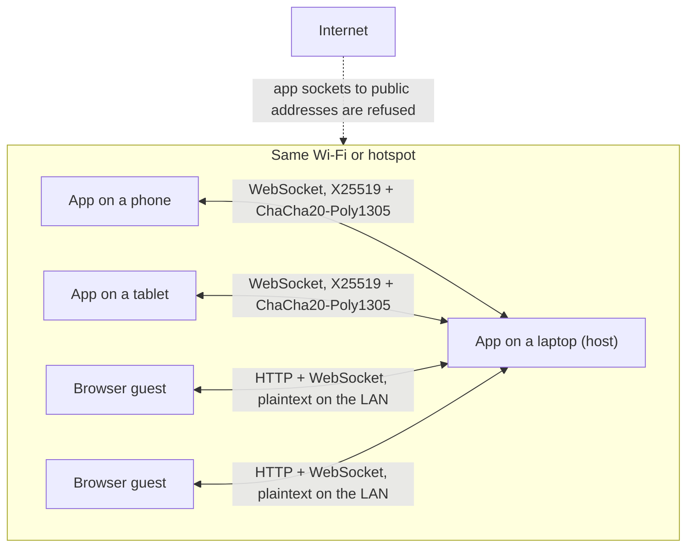
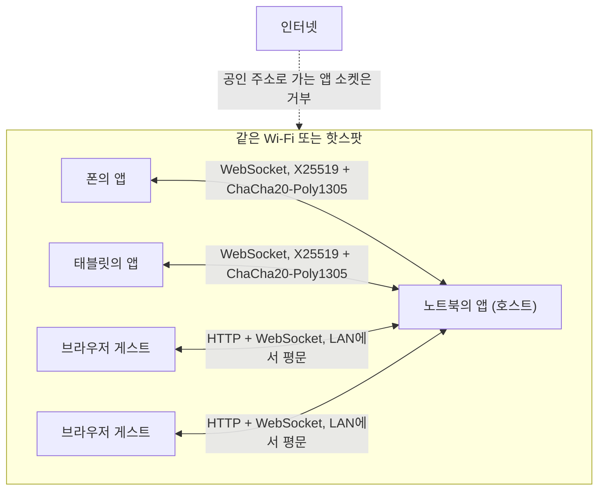

<div align="center">

# IntraGram

Peer-to-peer messenger for devices on the same network.<br>
No server, no account. Chats stay in memory unless you choose to keep them.

같은 네트워크 안의 기기끼리 쓰는 P2P 메신저.<br>
서버도 계정도 없고, 대화는 따로 보관하지 않는 한 메모리에만 남습니다.

[](https://github.com/gnoyx2/IntraGram/actions/workflows/ci.yml)
[](LICENSE)

[English](#english) · [한국어](#한국어)

</div>

---

## English

IntraGram is a messenger for phones, tablets and computers on the same Wi-Fi or LAN. The apps find each other with mDNS and connect directly, so there is no server, no sign-up and no phone number. Every socket the app opens has to go to a private address, and anything else is refused. Chats are kept in memory and reach the disk only if you turn on the local vault. People who don't have the app can join from a browser by scanning a QR code.

The name is *intranet* plus *-gram*. IntraGram is not affiliated with Instagram, Telegram or Meta.

[Status](#status) · [Features](#features) · [Why IntraGram](#why-intragram) · [Install](#install) · [Troubleshooting](#troubleshooting) · [Build from source](#build-from-source) · [How it works](#how-it-works) · [Project structure](#project-structure) · [Development and CI](#development-and-ci) · [Security model](#security-model) · [Contributing](#contributing) · [Credits](#credits) · [License](#license)

### Status

IntraGram is a release candidate (app 1.0.0, wire protocol 7). It builds for six platforms and includes a browser client, but no platform has passed the real-device checks in [DEVICE_QA.md](DEVICE_QA.md) yet, and the code has not had an independent security audit. Don't rely on it where a failure could put someone at risk.

| Platform | Minimum version | Release build | Signing | Device QA |
| :--- | :--- | :--- | :--- | :--- |
| Android | 7.0 (API 24) | APK per ABI | no release key yet, so no APK is published | not run |
| iOS, iPadOS | 15.0 | `.ipa` | unsigned | not run |
| macOS | 12.0 | universal app (`.zip`, `.dmg`) | ad-hoc, not notarized | not run |
| Windows | 10, x64 | portable `.zip` | not signed | not run |
| Linux | x64, GTK 3 | `.tar.gz` bundle (experimental) | none | not run |
| Browser guest | current browsers | page served by the host app | n/a | not run |

CI runs the test suite and an Android debug build on every push, and builds the Apple, Windows and Linux apps whenever their native code changes (see [Development and CI](#development-and-ci)). Automated tests do not replace a run on real devices and a real network.

Bug reports and questions go to Issues. Include your OS and device, the app version and the steps to reproduce, and remove message text, IP addresses, keys, tokens and PINs from logs and screenshots. Security problems go through the private route in [SECURITY.md](SECURITY.md), not an issue.

### Features

- 1:1 chats are end-to-end encrypted with X25519 and ChaCha20-Poly1305. Both screens show the same 6-digit code. Read it out loud once to make sure nobody is sitting in the middle; until then the chat is marked unverified.
- Group rooms use one app as the hub. Each member's link to the host is encrypted, but the host decrypts every message to relay it, so a room is encrypted hop by hop, not end to end. Room files go directly between devices without encryption, and the receiver checks them against a SHA-256 that arrives over the encrypted link. Every room shows a banner that says this.
- People without the app scan the QR code under *Guest portal* on the host and chat in their browser, with nothing to install. Up to 32 guests can share the portal room. A browser can't run the app's handshake, so guest traffic is plaintext on the local network. The portal room is separate from app group rooms.
- Files and whole folders of any size. They are streamed in 2 MiB chunks, so the limit is the receiver's free disk space, not RAM. Each transfer can be accepted, declined, cancelled or retried, and desktop builds accept drag and drop.
- Voice messages up to two minutes, held in memory and played through the OS audio API.
- Replies, reactions, typing and read indicators, delete for everyone, and search.
- A burn timer of 5, 30 or 60 seconds, off by default. The countdown starts when the other side reads the message. A timed message that is never read burns 24 hours after it was sent.
- An opt-in vault (*Settings › Keep chats on this device*) saves the messages and transfer history you choose to one file, optionally sealed with a PIN (PBKDF2 and ChaCha20-Poly1305). A separate duress PIN opens an empty session in which nothing is saved. Rooms are never saved.
- *Panic wipe* closes every link, releases the session in memory (overwriting the buffers the app owns), replaces the device identity and tries to delete the vault and the saved name. It can't guarantee that storage is physically erased.
- *Connect by IP* for networks that block multicast, or scan the other device's code.
- Notifications on Android, macOS and Linux while the app runs in the background and the link is up. Windows flashes the taskbar button instead. There is no server to wake a closed app, so a closed app receives nothing.
- The chat list stays beside the open chat from 840 pt wide, across a vertical fold or hinge, and on an unfolded phone. Desktop shortcuts: Cmd/Ctrl+F search, Cmd/Ctrl+N connect by IP, Cmd/Ctrl+, settings, Cmd/Ctrl+O send a file, Esc or Cmd/Ctrl+W close, Ctrl+Tab next chat, and Cmd/Ctrl with +, - or 0 for text size. The macOS menu bar has the same commands.
- English and Korean. The app follows the device language unless you pick one in Settings.
- Signed receipts for delivery, burn and cleanup, Merkle batches that a second device can verify and witness offline, offline organization credentials, and author signatures in app group rooms. This is local evidence, not consensus or a trusted timestamp. [SECURITY.md](SECURITY.md) explains what it proves and what it doesn't.

#### Known limits

- iOS suspends an app a few seconds after you leave it, so an iPhone or iPad stays connected only while IntraGram is open. Open it again and the other side can reconnect.
- Device IDs change at every launch, so a block lasts until one of you restarts the app. *Settings › Only chats I start* refuses chats and room invites from devices you haven't talked to since launch.
- Guest networks and many office, school and café networks stop devices from seeing each other. A phone hotspot works.
- All devices have to reach each other on one network. There is no mesh and no relay over the internet.
- A browser guest can send text and files, add a thumbs-up, use the burn timer and play voice messages, but it can't quote-reply. Its files go only to the host, and a file it downloads is held in browser memory until it is saved, so a very large file can fail on a phone.
- Received files go to the folder you pick on the first accept (desktop), to *Files › On My iPhone › IntraGram* (iPhone, iPad), or to the app's private folder (Android, where *Share or save* on the file moves it elsewhere).
- The iOS photo picker sends photos only, up to 10 at a time and 50 MiB in total. Send videos from the Files app.

### Why IntraGram

A message to a colleague two meters away usually goes through a data center somewhere else and stays there. [LocalSend](https://github.com/localsend/localsend) solved this for files: same Wi-Fi, no cloud, no account. It sends files and one-off texts, though, not conversations. IntraGram takes the same idea to chat. It does not talk to LocalSend apps, since discovery and protocol are different.

| | AirDrop | Telegram | LocalSend | IntraGram |
| :--- | :--- | :--- | :--- | :--- |
| Works without internet | yes | no | yes | yes |
| Needs an account or phone number | no | yes | no | no |
| Chat (typing, read receipts, replies, reactions) | no | yes | no | yes |
| Group chat | no | yes, through its servers | no | yes, one device is the hub |
| What stays behind | received files | cloud chats on its servers (secret chats aside) | received files | files you accept; chats only with the vault on |
| Platforms | Apple devices (Pixel 10 through Quick Share) | all | all | iOS, iPadOS, Android, macOS, Windows, Linux, browser |

[Briar](https://briarproject.org/) and Bitchat also chat without servers or accounts, over Bluetooth, Wi-Fi or Tor, and Quick Share moves files between nearby Android and Windows devices. IntraGram needs a shared LAN or hotspot and has no mesh relay. In exchange it runs on every major OS, and anyone with a browser can join the host's portal room from a QR code.

It fits places where the internet is blocked, slow or unwanted: an internal network with no outside access, a factory floor, a ship or test site, a classroom or lab full of mixed laptops and phones, or a meeting where a few people need a room for an hour without trading phone numbers.

### Install

Phones have no signed build yet. Android has no release key, so no APK is published, and the iOS `.ipa` is unsigned. The quickest way to try IntraGram today is a desktop build with phones joining through *Guest portal* in a browser, or a build from source.

Tagged builds are attached to [Releases](https://github.com/gnoyx2/IntraGram/releases) as pre-releases, together with `SHA256SUMS.txt` and a `SIGNING-<platform>.txt` per platform that records how each file was signed. Check a download with `shasum -a 256 -c --ignore-missing SHA256SUMS.txt` on macOS, `sha256sum -c --ignore-missing SHA256SUMS.txt` on Linux, or `Get-FileHash <file> -Algorithm SHA256` in PowerShell. The checksums only catch a broken download. `gh attestation verify <file> --repo gnoyx2/IntraGram` checks that the release workflow built the file.

IntraGram only listens on and connects to private addresses, so allow firewall prompts for private networks only.

- **macOS**: ad-hoc signed and not notarized, so Gatekeeper blocks the first launch. On macOS 15 and later, open the app once, then click *Open Anyway* in *System Settings › Privacy & Security*. On macOS 12 to 14, right-click the app and choose *Open*. Allow the Local Network prompt.
- **Windows**: unzip the whole folder and run `intragram.exe`. SmartScreen warns about an unsigned app (*More info*, then *Run anyway*). With Smart App Control turned on, Windows blocks unsigned apps without an exception, so IntraGram won't run on that PC until it is signed.
- **Linux**: extract the archive and run `./intragram`. `./install.sh` adds it to the app menu with its icon (`./install.sh --uninstall` removes it; run it again if you move the folder). It needs `libgtk-3`, `avahi-daemon` for discovery, `xdg-desktop-portal` with a GTK, GNOME or KDE backend for file dialogs, PulseAudio tools (`parecord`, `pacat`) or PipeWire tools (`pw-record`, `pw-play`) for voice, and `xdg-utils` to open received files. Package names differ between distributions.
- **iOS, iPadOS**: the `.ipa` is unsigned. Sideload it with AltStore or Sideloadly, which sign it with your Apple ID (a free account's signature expires after 7 days), or build from source in Xcode with your own team.
- **Android**: an APK will be attached once it can be signed with the project's release key. Pick `arm64-v8a` for any recent phone.

The vault (`vault.json`) and a remembered display name (`identity.json`) live in the app's Application Support/IntraGram folder, apart from received files. On iOS the app asks for backup exclusion and complete file protection for that folder. macOS backups can include the vault. Android's OS backup and device transfer of app data are turned off. [PRIVACY.md](PRIVACY.md) lists everything the app keeps and sends.

### Troubleshooting

- **The other device doesn't show up.** Both devices have to be on the same Wi-Fi. Guest networks and most office, school and café Wi-Fi keep devices apart (AP isolation), so turn on a phone hotspot and join it with both. You can also use *Connect by IP* with the address on the other device's home screen, or scan its device code.
- **"This Wi-Fi can't be used for IntraGram".** The network gave the device a public or carrier (`100.64.x.x`) address, and IntraGram only talks over private addresses. Use a phone hotspot.
- **An iPhone, iPad or Mac finds nothing.** Turn on Local Network access for IntraGram: *Settings › IntraGram* on iOS and iPadOS, *System Settings › Privacy & Security › Local Network* on macOS.
- **Windows or Linux finds nothing, or nobody can connect to it.** Allow IntraGram through Windows Firewall on private networks and check that the Wi-Fi is set to a private network. On Linux, open the port shown on the home screen in `ufw` or `firewalld`.
- **A VPN is on.** Many VPN apps send local traffic into the tunnel or block it. Turn on the VPN's local network option, or turn the VPN off while chatting.
- **The browser page says the entry code is missing or the portal is off.** Open the full address from *Guest portal* (it ends in `#t=...`) or scan the QR code again. Reloading in the same tab keeps you in, but turning the portal off, or on again, makes a new code and sends every guest back to the QR code.
- **Microphone or camera access was denied.** Tap *Open Settings* in the app's notice, or allow it in the system settings.

### Build from source

You need:

- Flutter 3.44.9 (stable), the version CI pins.
- iOS: Xcode 27.1 with the iOS 27.1 SDK. [Xcode 27.1 needs macOS 26.6 or later](https://developer.apple.com/xcode/system-requirements). macOS: Xcode.
- Android: Android SDK 36 and JDK 17.
- Windows: Visual Studio 2022 with the C++ desktop workload.
- Linux: `clang cmake ninja-build pkg-config libgtk-3-dev`.

```bash
flutter pub get --enforce-lockfile
flutter run     # pick a device, then start IntraGram on a second device on the same Wi-Fi
```

| OS | Release build | Output |
| :--- | :--- | :--- |
| Android | `flutter build apk --release --split-per-abi` | `build/app/outputs/flutter-apk/` |
| iOS, iPadOS | `flutter build ios --release` (needs signing) | Xcode archive |
| macOS | `flutter build macos --release` | `build/macos/Build/Products/Release/` |
| Windows | `flutter build windows --release` | `build/windows/x64/runner/Release/` |
| Linux | `flutter build linux --release` | `build/linux/x64/release/bundle/` |

Signing, store uploads and the release workflow are in [RELEASING.md](RELEASING.md).

### How it works



- **Discovery and server.** Each app advertises `_intragram._tcp` over mDNS (`bonsoir`) and runs an embedded `shelf` server on a private address, on port 7890 or the next free port. The server has five routes: `/` for the browser client, `/ws` for the WebSocket upgrade, `POST /api/transfer` for incoming file bytes, `GET /api/download/<id>` for files that room members and browsers pull, and `/health`.
- **Handshake.** The dialing app opens a WebSocket and both apps run an ephemeral X25519 key agreement. The dialer commits to its key first, so neither side can pick a key after seeing the other's. Both sign the handshake with an Ed25519 identity key made at launch and kept only in RAM; the peer ID is a hash of that key. HKDF-SHA256 derives separate message and file keys for each direction, and the 6-digit code.
- **Frames.** Messages are JSON frames sealed with ChaCha20-Poly1305. The nonce is a strict sequence number, and a skipped number ends the link.
- **Files.** In a 1:1 chat the sender streams the file to the receiver's `/api/transfer` in 2 MiB chunks, each sealed with the file key. In a room the receiver pulls the plain bytes from the sender's `/api/download/<id>` and compares them with the SHA-256 from the encrypted offer.
- **Rooms and guests.** A room host keeps one link per member and forwards only frame types on an allow list. A browser guest gets a single HTML page with its CSS and JavaScript inlined and a strict Content Security Policy, and the page talks only to the host that served it.

#### Wire protocol

`kProtocolVersion` in `lib/core/constants.dart`, mirrored by `PROTOCOL_VERSION` in `assets/web/js/socket.js`, is a hard gate: a `hello` or `web_hello` with any other version is refused at the handshake. Update every app together and reload open browser guests. `test/protocol_version_test.dart` pins the value.

- **v7** makes the dialer commit to its ephemeral key before the listener answers. The dialer's `hello` carries only `cmt`, a SHA-256 over its ephemeral X25519 key and its identity key. The listener replies with its own ephemeral key and a signature over that commitment, and only then does the dialer reveal its key in `auth`, which the listener checks against `cmt` (`lib/network/peer_auth.dart`). A relay that wants both screens to show the same code can only abort and redial until the codes match by chance, about a million tries on average, which the inbound limits stretch to more than a day. Encrypted frames use the sequence number as the nonce, and a skipped number ends the link. A room `file_offer` may carry `dg`, the base64 SHA-256 of the file, which the receiving app checks after the pull; older v7 apps ignore it.
- **v6** adds `file_unavailable`. When a room host cannot hand a member's file offer to the recipient it names (the recipient left, is shutting down, or the write failed), it tells the sender instead of leaving that recipient waiting. Only the room's confirmed host may send it.
- **v5** makes peer IDs verifiable. The ID is the first 16 bytes of the SHA-256 of a per-launch Ed25519 public key (`idk` in `hello`). The listener signs its `hello` (`sig`) and the dialer answers with an `auth` frame. Both signatures cover the version, the role, both ephemeral keys and both identity keys, so a proof can't be replayed in another session, reused in the other role or aimed at another peer.
- **v4** adds the room roster (`peers` in `room_join` and `room_state`) and per-recipient file offers (`file_offer.to`, routed by `lib/network/link_registry/room_file_routing.dart`).

#### Design rules

1. **Nothing on disk by default.** There is no SQLite, Hive, `SharedPreferences` or `localStorage` in the tree. The persistent data the app manages is limited to files you accept into a folder you chose (desktop also records that folder in `download_directories.json`, as a sandbox bookmark on macOS, so a half-received file can be removed after a crash), the vault if you turn it on, and a display name you choose to remember (inside the vault, or in plaintext `identity.json` when the vault is off). Byte buffers the app owns, such as frame plaintext, file chunks, voice audio and the session and vault keys, are overwritten when released. Message text passes through Dart strings, which can't be overwritten, so the store only drops its reference; copies made inside the crypto library are also only released. File pickers, share sheets and the OS can still leave temporary copies and caches.
2. **Private addresses only.** `NetworkGuard` (`lib/core/network_guard.dart`) classifies every address. The server binds to a private IPv4 address (a link-local one if that is all the network offers, or an IPv6 unique local address when there is no IPv4 LAN), and an outbound socket throws `SecurityException` unless the target is in `10/8`, `172.16/12`, `192.168/16`, loopback, `169.254/16`, `::1` or `fc00::/7`. Dialing a peer is stricter: `NetworkGuard.parsePeerEndpoint` accepts only canonical dotted-decimal RFC 1918 IPv4, whether the address came from discovery, a QR code or the IP dialog. This checks where the app's own sockets go. It is not a firewall or an air gap: a VPN that hands out private addresses carries the traffic through its tunnel, a link you tap opens in your browser, and a file you open goes to another app.
3. **One codebase.** One Flutter codebase for iOS, iPadOS, Android, macOS, Windows and Linux, plus a browser client in plain HTML, CSS and JavaScript that the app serves itself.

### Project structure

```text
.
├── lib/
│   ├── main.dart            startup: leftover file cleanup, per-launch identity, wipe on desktop shutdown
│   ├── app.dart             MaterialApp, theme, locale, PIN gate and auto-lock
│   ├── app_commands.dart    keyboard shortcuts and macOS menu commands
│   ├── app_lock.dart        relock: seal the vault, stop links, wipe memory
│   ├── app_providers/       Riverpod providers that connect store, network and vault
│   ├── core/                NetworkGuard, path safety, OS privacy and clipboard,
│   │                        notifications, voice, identity, QR decoding
│   ├── network/             discovery, embedded server, peer links, handshake and crypto,
│   │                        wire protocol, link registry (chats and rooms), file transfers,
│   │                        organization credentials, room integrity
│   ├── store/               in-memory store, immutable models, opt-in vault
│   ├── audit/               signed receipts, Merkle batches, anchor bundles
│   ├── features/            screens: home, chat, connect, portal, search, settings
│   ├── l10n/                English and Korean strings
│   ├── theme/               design tokens, color schemes, adaptive layout
│   └── widgets/             shared widgets
├── assets/web/              browser guest client (HTML, CSS, JavaScript, no external files)
├── test/                    unit and integration tests; test/ui for widgets, test/support for rigs
├── tool/                    line-count check, Node checks for the web client,
│                            icon generation, Linux desktop helper test
├── android/ ios/ macos/ windows/ linux/
│                            platform runners and native channels (see below)
└── .github/                 CI workflows, issue and pull request templates
```

The native side is small. Dart talks to it over a few channels (`intragram/privacy`, `intragram/screenshot`, `intragram/foreground`, `intragram/file_source`, `intragram/voice`, `intragram/menu`, `intragram/file_protection`).

| Platform | Files | What they do |
| :--- | :--- | :--- |
| Android | `MainActivity.kt`, `ConnectionService.kt`, `MemoryFileSource.kt`, `VoicePlayerChannel.kt` | `FLAG_SECURE`, screenshot detection, the optional foreground service, sensitive clipboard, picked files and voice playback from memory |
| iOS | `AppDelegate.swift`, `SceneDelegate.swift`, `DisplayRegions.swift`, `MemoryFileSource.swift`, `VoicePlayer.swift` | privacy cover, file protection for app data, fold regions on iOS 27.1, photo picker, voice playback |
| macOS | `AppDelegate.swift`, `MainFlutterWindow.swift`, `VoicePlayer.swift` | menu bar, window sharing hint, screenshot detection, voice playback |
| Windows | `flutter_window.cpp`, `win32_window.cpp`, `win32_window_proc.cpp` | taskbar flashing, capture exclusion, accessibility settings (the clipboard expiry is Dart FFI in `lib/core/windows_clipboard.dart`) |
| Linux | `my_application.cc`, `native_privacy.cc`, `desktop_environment.h` | client or server-side decorations per desktop, XDG portal appearance settings, clipboard hints |

### Development and CI

Run the same checks as CI from the repository root:

```bash
flutter pub get --enforce-lockfile
dart format --output=none --set-exit-if-changed .
python3 tool/check_loc.py            # no first-party .dart file over 250 lines
flutter analyze                      # stays at 0 issues
flutter test --exclude-tags large    # unit, integration and widget tests
node tool/browser_guard_test.js      # runs the real web client JS in Node: LAN address guard, guest page behavior
node tool/web_design_test.js         # guest page branding, contrast and layout
git diff --check
```

`flutter test --tags large` runs the slow 64 and 256 MiB streaming and memory tests; add `--dart-define=LARGE_SIZES_MIB=1024,4096` for 1 and 4 GiB. CI leaves this suite out.

Three workflows live in `.github/workflows/`. Third-party actions are pinned to commit SHAs and the default token is read-only.

| Workflow | Trigger | What it does |
| :--- | :--- | :--- |
| `ci.yml` | every push and pull request | `verify` on Ubuntu runs the checks above; `android` builds a debug APK |
| `native.yml` | changes under `ios/`, `macos/`, `windows/`, `linux/` or in `pubspec`, or a manual run | debug builds of macOS and iOS (Xcode 27.1), Windows (`windows-2022`) and Linux (`ubuntu-24.04`), plus a C++ test of the Linux desktop helpers and a syntax check of `install.sh` |
| `release.yml` | a `v*` tag, or a manual run | runs `verify` again, builds release files for every platform and writes `SIGNING-<platform>.txt` from the built files. On a tag it adds `SHA256SUMS.txt` and a build provenance attestation and opens a draft release, marked pre-release until the repository variable `DEVICE_QA_PASSED` is `true` |

A debug-signed Android APK is never attached to a release; it stays a workflow artifact for testing. The full release procedure is in [RELEASING.md](RELEASING.md).

`test/` has one file per concern:

| Area | Tests |
| :--- | :--- |
| Private addresses and path safety | `network_guard_test`, `path_safety_test` |
| Crypto and identity | `crypto_engine_test`, `sas_generator_test`, `peer_auth_weak_key_test`, `peer_link_identity_*_test` |
| Wire protocol | `protocol_*_test`, `handshake_e2ee_*_test` |
| File transfer | `file_transfer_*_test`, `file_chunks_test`, `large_transfer_test` (tag `large`) |
| Group rooms and portal | `member_room_*_test`, `portal_relay_*_test` |
| Link admission | `link_registry_pre_proof_test`, `link_registry_pending_cap_test`, `link_registry_admission_test` |
| Evidence and credentials | `audit_*_test`, `delivery_receipt_test`, `org_credential*_test`, `room_integrity*_test` |
| Vault and wipe | `vault_*_test`, `panic_*_test` |
| Native configuration | `android_manifest_test`, `macos_release_entitlements_test` |
| UI | `test/ui/`, one file per screen or behavior |

### Security model

What it is built to defend against:

- **Other devices on the LAN.** A 1:1 link is end-to-end encrypted and the peer's ID is proven by a signature, so another device can't read the chat, rejoin a room as someone else or answer an invite meant for another device. Comparing the 6-digit code catches a relayed handshake. If the same device reconnects while both apps are still running, it has to prove the same identity key, so a code you already confirmed stays confirmed. After either app restarts, compare again.
- **Idle sockets that lock others out.** One device can hold 4 unfinished handshakes (16 in total) and connect at most 24 times per 10 seconds (96 in total).
- **Traffic leaving the network.** Every socket the app opens goes through `NetworkGuard` and only reaches private addresses.
- **Data left behind.** No chat is written to disk unless you turn on the vault. *Panic wipe* releases what the app holds in memory and tries to delete what it stored, without a promise of physical erasure.

What it does not cover:

- The host of a group room can read the whole room, and room files cross the LAN unencrypted.
- Browser guests can't run the handshake, so their traffic is plaintext on the local link.
- Names and platforms shown in the app are self-declared, and a first contact is only as trustworthy as the code you compared.
- The app fetches nothing by itself, but a link you tap opens in your browser after you confirm the real address (shown in punycode when it mixes scripts), and a received file you open is handed to another app. The app asks first for file types such as web pages and shortcuts.
- The QR scanner decodes camera frames on the device with `zxing2`, a pure-Dart port of ZXing, and has no network component.

The full threat model and the reporting policy are in [SECURITY.md](SECURITY.md), and what the app keeps and sends is in [PRIVACY.md](PRIVACY.md). Nothing here has had an independent audit.

### Contributing

Pull requests are welcome. The codebase stays small on purpose: no code generation, and each file should read top to bottom in one sitting. Good first issues: more file-kind icons, better transfer stats, a Windows Explorer polish pass, tests for link-teardown races.

Rules for every pull request:

- `flutter analyze` stays at 0 issues, all tests pass, `dart format` is clean, and no first-party `.dart` file goes over 250 lines (`tool/check_loc.py`).
- No new storage on disk beyond what the [design rules](#design-rules) allow. No SQLite, Hive, `SharedPreferences` or `localStorage`.
- Every socket goes through `NetworkGuard`. A change that skips it is out of scope.
- Wire changes bump the protocol: move `kProtocolVersion` and `PROTOCOL_VERSION` in `assets/web/js/socket.js` together. A new broadcast-style frame has to be added to the `relayable` set in `lib/network/link_registry/room.dart` before a room host forwards it; `file_*` frames are routed per transfer in `room_file_routing.dart`.
- User-facing strings go through `s.t('key')` in `lib/l10n/`, in English and Korean (`test/l10n_parity_test.dart` checks both). State models are immutable (`copyWith`).
- Don't add a package for what a few lines can do.

Signing material never goes in the repository. [CONTRIBUTING.md](CONTRIBUTING.md) has the setup and the pull request checklist, [CHANGELOG.md](CHANGELOG.md) lists changes, and [CODE_OF_CONDUCT.md](CODE_OF_CONDUCT.md) covers how we treat each other. Contributions are accepted under the MIT License.

### Credits

Thanks to [LocalSend](https://github.com/localsend/localsend). The "same Wi-Fi, no cloud, no account" idea behind IntraGram came from using it. Two small parts are modified from its Apache-2.0 source: the file-type and icon mapping (`lib/core/file_kind.dart`) and the time-left calculation (`_formatEta` in `lib/features/chat/transfer_tile/received_actions.dart`). The open-file and show-in-folder flow (`lib/core/native_open.dart`) only borrows the idea and is written independently. If all you need is a good cross-platform file sender, use LocalSend.

### License

MIT, see [LICENSE](LICENSE). The two files modified from LocalSend also carry the Apache License 2.0, as their SPDX headers say. Third-party licenses are in [THIRD_PARTY_NOTICES.md](THIRD_PARTY_NOTICES.md), and the app shows all of them under *Settings › App › Open-source licenses*.

---

## 한국어

IntraGram은 같은 Wi-Fi나 LAN에 있는 폰, 태블릿, 컴퓨터끼리 쓰는 메신저입니다. 앱끼리 mDNS로 서로를 찾아 직접 연결하므로 서버도, 가입도, 전화번호도 필요 없습니다. 앱이 여는 소켓은 모두 사설 주소로만 가야 하고, 그 밖의 주소는 거부합니다. 대화는 메모리에 두며, 로컬 보관소를 켰을 때만 디스크에 저장합니다. 앱이 없는 사람도 QR 코드를 찍어 브라우저로 들어올 수 있습니다.

이름은 *intranet*과 *-gram*을 합친 것입니다. IntraGram은 Instagram, Telegram, Meta와 관계가 없습니다.

[현재 상태](#현재-상태) · [기능](#기능) · [왜 만들었나](#왜-만들었나) · [설치](#설치) · [문제 해결](#문제-해결) · [소스에서 빌드](#소스에서-빌드) · [동작 방식](#동작-방식) · [프로젝트 구조](#프로젝트-구조) · [개발과 CI](#개발과-ci) · [보안 모델](#보안-모델) · [기여](#기여) · [감사의 말](#감사의-말) · [라이선스](#라이선스)

### 현재 상태

릴리스 후보 단계입니다(앱 1.0.0, 와이어 프로토콜 7). 여섯 개 플랫폼용으로 빌드되고 브라우저 클라이언트도 들어 있지만, [DEVICE_QA.md](DEVICE_QA.md)의 실기기 점검을 통과한 플랫폼은 아직 없고 외부 보안 감사도 받지 않았습니다. 문제가 생겼을 때 누군가 위험해질 수 있는 곳에서는 쓰지 마세요.

| 플랫폼 | 최소 버전 | 릴리스 빌드 | 서명 | 실기기 QA |
| :--- | :--- | :--- | :--- | :--- |
| Android | 7.0 (API 24) | ABI별 APK | 릴리스 키가 아직 없어 APK를 공개하지 않음 | 미실시 |
| iOS, iPadOS | 15.0 | `.ipa` | 서명 없음 | 미실시 |
| macOS | 12.0 | universal 앱 (`.zip`, `.dmg`) | ad-hoc 서명, 공증 없음 | 미실시 |
| Windows | 10, x64 | 포터블 `.zip` | 서명 없음 | 미실시 |
| Linux | x64, GTK 3 | `.tar.gz` 번들 (실험 단계) | 없음 | 미실시 |
| 브라우저 게스트 | 최신 브라우저 | 호스트 앱이 내려주는 페이지 | 해당 없음 | 미실시 |

CI는 push마다 테스트와 Android 디버그 빌드를 돌리고, 네이티브 코드가 바뀌면 Apple, Windows, Linux 앱도 빌드합니다([개발과 CI](#개발과-ci) 참고). 자동 테스트가 실기기와 실제 네트워크에서 돌려 보는 일을 대신하지는 않습니다.

버그와 질문은 Issues에 남겨 주세요. OS와 기기, 앱 버전, 재현 순서를 적고, 로그와 스크린샷에서 대화 내용, IP 주소, 키, 토큰, PIN은 지워 주세요. 보안 문제는 이슈가 아니라 [SECURITY.md](SECURITY.md)의 비공개 경로로 알려 주세요.

### 기능

- 1:1 대화는 X25519와 ChaCha20-Poly1305로 종단 간 암호화됩니다. 양쪽 화면에 같은 6자리 코드가 뜹니다. 한 번 소리 내어 맞춰 보면 중간에 누가 끼어들지 않았는지 확인할 수 있고, 맞춰 보기 전까지는 대화에 미확인 표시가 붙습니다.
- 그룹 방은 앱 하나가 허브가 됩니다. 멤버와 호스트 사이의 연결은 각각 암호화되지만 호스트가 메시지를 복호화해서 중계하므로, 종단 간이 아니라 구간별(hop-by-hop) 암호화입니다. 방에서 보낸 파일은 암호화 없이 기기끼리 바로 오가고, 받는 쪽은 암호화된 연결로 먼저 받은 SHA-256으로 내용을 확인합니다. 방마다 위쪽 배너에 이 사실이 표시됩니다.
- 앱이 없는 사람은 호스트의 *게스트 포털* QR 코드를 찍으면 아무것도 설치하지 않고 브라우저에서 바로 대화합니다. 포털 방 하나에 게스트 32명까지 들어옵니다. 브라우저는 앱의 핸드셰이크를 할 수 없어서 게스트 트래픽은 로컬 네트워크에서 평문으로 오갑니다. 포털 방은 앱 그룹 방과 따로 돌아갑니다.
- 파일과 폴더를 크기 제한 없이 보냅니다. 2 MiB 단위로 나눠 흘려보내므로 한계는 RAM이 아니라 받는 쪽의 남은 디스크 용량입니다. 전송마다 수락, 거절, 취소, 재시도를 할 수 있고 데스크톱에서는 끌어다 놓기도 됩니다.
- 최대 2분짜리 음성 메시지를 보냅니다. 메모리에만 두고 OS 오디오 API로 재생합니다.
- 답장, 리액션, 입력 중·읽음 표시, 모두에게서 삭제, 검색을 지원합니다.
- 소각 타이머는 기본으로 꺼져 있고 5초, 30초, 60초 중에서 고릅니다. 상대가 메시지를 읽는 순간부터 시간이 줄고, 끝내 읽히지 않은 메시지는 보낸 지 24시간 뒤에 소각됩니다.
- 보관소(*설정 › 이 기기에 대화 보관*)는 기본으로 꺼져 있습니다. 켜면 고른 범위(메시지, 전송 기록)를 파일 하나에 저장하고, PIN으로 잠글 수 있습니다(PBKDF2, ChaCha20-Poly1305). 따로 정하는 협박 대비 PIN으로 열면 빈 세션이 뜨고, 그 안에서 한 일은 저장되지 않습니다. 방은 저장하지 않습니다.
- *긴급 소거*는 모든 연결을 끊고, 메모리의 세션을 해제하고(앱이 가진 버퍼는 덮어씀), 기기 신원을 새로 만든 뒤 보관소와 저장한 이름을 지우려고 시도합니다. 저장 장치에서 물리적으로 완전히 지워진다는 보장은 없습니다.
- 멀티캐스트를 막는 네트워크에서는 *IP로 연결*을 쓰거나 상대 기기의 코드를 스캔합니다.
- Android, macOS, Linux에서는 앱이 백그라운드에 있고 연결이 살아 있으면 알림이 옵니다. Windows는 대신 작업 표시줄 버튼을 깜빡입니다. 닫힌 앱을 깨울 서버가 없으므로 완전히 닫힌 앱에는 아무것도 오지 않습니다.
- 폭이 840pt 이상이거나, 세로 접힘선이나 힌지가 있거나, 펼친 폰이면 대화 목록과 열린 대화를 나란히 보여 줍니다. 데스크톱 단축키는 Cmd/Ctrl+F 검색, Cmd/Ctrl+N IP로 연결, Cmd/Ctrl+, 설정, Cmd/Ctrl+O 파일 보내기, Esc나 Cmd/Ctrl+W 닫기, Ctrl+Tab 다음 대화, Cmd/Ctrl와 +, -, 0 글자 크기입니다. macOS 메뉴 막대에도 같은 명령이 있습니다.
- 한국어와 영어를 지원합니다. 기기 언어를 따르고, 설정에서 고정할 수도 있습니다.
- 전달·소각·정리 서명 영수증, 다른 기기가 오프라인으로 검증하고 증인 서명을 해 주는 Merkle 배치, 오프라인 조직 자격 확인, 앱 그룹 방의 작성자 서명이 있습니다. 기기 안에 남는 증적일 뿐 합의나 공인 시각은 아닙니다. 무엇을 증명하고 무엇을 증명하지 못하는지는 [SECURITY.md](SECURITY.md)에 적어 두었습니다.

#### 알려진 한계

- iOS는 앱에서 나가면 몇 초 뒤 앱을 멈춥니다. 그래서 iPhone과 iPad는 IntraGram을 열어 둔 동안만 연결되고, 다시 열면 상대가 다시 연결할 수 있습니다.
- 기기 ID는 실행할 때마다 바뀌어서, 차단은 둘 중 한쪽이 앱을 다시 켤 때까지만 유지됩니다. *설정 › 내가 연 대화만 받기*를 켜면 이번 실행에서 대화한 적 없는 기기의 대화 요청과 방 초대를 거절합니다.
- 게스트 Wi-Fi와 많은 회사·학교·카페 Wi-Fi는 기기끼리 서로 보지 못하게 막습니다. 폰 핫스팟을 쓰면 됩니다.
- 모든 기기가 한 네트워크 안에서 서로 닿아야 합니다. 메시 중계도, 인터넷을 거치는 중계도 없습니다.
- 브라우저 게스트는 텍스트와 파일을 보내고, 좋아요 반응을 달고, 소각 타이머를 쓰고, 음성 메시지를 들을 수 있지만 인용 답장은 못 합니다. 게스트가 보낸 파일은 호스트에게만 갑니다. 게스트가 받는 파일은 저장하기 전까지 브라우저 메모리에 통째로 올라가므로 아주 큰 파일은 폰에서 실패할 수 있습니다.
- 받은 파일은 데스크톱에서는 처음 수락할 때 고른 폴더, iPhone과 iPad에서는 *파일 › 나의 iPhone › IntraGram*, Android에서는 앱 전용 폴더에 저장됩니다. Android에서는 파일의 *공유·저장*으로 다른 곳에 옮기세요.
- iOS 사진 선택기는 사진만 보냅니다. 한 번에 10장, 합계 50 MiB까지이고, 동영상은 파일 앱에서 보내면 됩니다.

### 왜 만들었나

2미터 옆에 앉은 동료에게 보낸 메시지도 보통은 먼 데이터센터를 거쳐 가고, 거기 남습니다. [LocalSend](https://github.com/localsend/localsend)는 같은 Wi-Fi 안에서 클라우드와 계정 없이 파일을 주고받게 해서 파일 전송에서는 이 문제를 풀었습니다. 다만 LocalSend가 다루는 건 파일과 한 번짜리 텍스트이고 대화는 아닙니다. IntraGram은 같은 생각을 대화로 옮긴 것입니다. 기기 탐색과 프로토콜이 달라서 LocalSend 앱과는 통신하지 않습니다.

| | AirDrop | Telegram | LocalSend | IntraGram |
| :--- | :--- | :--- | :--- | :--- |
| 인터넷 없이 동작 | 예 | 아니오 | 예 | 예 |
| 계정·전화번호 필요 | 아니오 | 예 | 아니오 | 아니오 |
| 대화 기능(입력 중, 읽음, 답장, 리액션) | 아니오 | 예 | 아니오 | 예 |
| 그룹 대화 | 아니오 | 예, 서버 경유 | 아니오 | 예, 기기 하나가 허브 |
| 남는 기록 | 받은 파일 | 클라우드 대화는 서버에 남음(비밀 대화 제외) | 받은 파일 | 수락한 파일. 대화는 보관소를 켰을 때만 |
| 플랫폼 | Apple 기기(Pixel 10은 Quick Share로) | 전체 | 전체 | iOS, iPadOS, Android, macOS, Windows, Linux, 브라우저 |

[Briar](https://briarproject.org/)와 Bitchat도 서버나 계정 없이 블루투스, Wi-Fi, Tor로 대화하고, Quick Share는 가까운 Android·Windows 기기끼리 파일을 옮깁니다. IntraGram은 같은 LAN이나 핫스팟이 있어야 하고 메시 중계도 없습니다. 대신 주요 OS를 모두 대상으로 하고, 브라우저만 있으면 누구나 QR 코드로 호스트의 포털 방에 들어올 수 있습니다.

인터넷이 막혔거나 느리거나 쓰고 싶지 않은 곳에 맞습니다. 외부 접속이 없는 사내망, 공장, 선박이나 시험장, 노트북과 폰이 섞인 강의실과 실습실, 전화번호를 주고받지 않고 한 시간쯤 대화방이 필요한 모임 같은 곳입니다.

### 설치

폰용 서명 빌드는 아직 없습니다. Android는 릴리스 키가 없어 APK를 공개하지 않고, iOS `.ipa`는 서명되지 않았습니다. 지금 써 보려면 데스크톱 빌드를 띄우고 폰은 *게스트 포털*로 브라우저에서 들어오게 하거나, 소스에서 직접 빌드하는 쪽이 가장 빠릅니다.

버전 태그를 올리면 빌드가 [Releases](https://github.com/gnoyx2/IntraGram/releases)에 프리릴리스로 올라옵니다. `SHA256SUMS.txt`와 함께, 플랫폼마다 서명 상태를 빌드 중에 직접 잰 `SIGNING-<platform>.txt`가 붙습니다. 내려받은 파일은 macOS에서 `shasum -a 256 -c --ignore-missing SHA256SUMS.txt`, Linux에서 `sha256sum -c --ignore-missing SHA256SUMS.txt`, Windows PowerShell에서 `Get-FileHash <파일> -Algorithm SHA256`으로 확인합니다. 체크섬은 깨진 다운로드만 잡아냅니다. 릴리스 워크플로가 직접 만든 파일인지는 `gh attestation verify <파일> --repo gnoyx2/IntraGram`으로 확인합니다.

IntraGram은 사설 주소에서만 연결을 받고 겁니다. 방화벽 팝업은 개인 네트워크에서만 허용하세요.

- **macOS**: ad-hoc 서명에 공증이 없어서 처음 실행할 때 Gatekeeper가 막습니다. macOS 15 이상은 앱을 한 번 연 뒤 *시스템 설정 › 개인정보 보호 및 보안*에서 *그래도 열기*를 누르고, macOS 12~14는 앱을 우클릭해서 *열기*를 고릅니다. 로컬 네트워크 접근 팝업은 허용합니다.
- **Windows**: 폴더째 압축을 풀고 `intragram.exe`를 실행합니다. 서명이 없어 SmartScreen이 경고하면 *추가 정보*를 누른 뒤 *실행*을 누르세요. 스마트 앱 컨트롤이 켜진 PC는 서명 없는 앱을 예외 없이 막으므로, 서명하기 전까지는 그 PC에서 실행할 수 없습니다.
- **Linux**: 압축을 풀고 `./intragram`을 실행합니다. `./install.sh`는 아이콘과 함께 앱 메뉴에 등록합니다(`./install.sh --uninstall`로 제거, 폴더를 옮겼다면 다시 실행). 실행하려면 `libgtk-3`, 기기 탐색용 `avahi-daemon`, 파일 대화상자용 `xdg-desktop-portal`과 GTK·GNOME·KDE 백엔드 중 하나, 음성용 PulseAudio 도구(`parecord`, `pacat`)나 PipeWire 도구(`pw-record`, `pw-play`), 받은 파일을 열 `xdg-utils`가 필요합니다. 패키지 이름은 배포판마다 다릅니다.
- **iOS, iPadOS**: `.ipa`는 서명이 없습니다. AltStore나 Sideloadly로 본인 Apple ID 서명을 해서 설치하거나(무료 계정 서명은 7일 뒤 만료), Xcode에서 본인 팀으로 소스를 빌드하세요.
- **Android**: 프로젝트 릴리스 키로 서명할 수 있게 되면 APK를 첨부합니다. 최근 폰이면 `arm64-v8a`를 고르면 됩니다.

보관소(`vault.json`)와 기억해 둔 기기 이름(`identity.json`)은 받은 파일과 떨어진 앱의 Application Support/IntraGram 폴더에 있습니다. iOS에서는 이 폴더에 백업 제외와 완전 파일 보호를 요청합니다. macOS 백업에는 보관소가 들어갈 수 있습니다. Android는 앱 데이터의 OS 백업과 기기 간 전송을 꺼 두었습니다. 앱이 남기고 보내는 것은 [PRIVACY.md](PRIVACY.md)에 모두 적어 두었습니다.

### 문제 해결

- **상대 기기가 안 보입니다.** 두 기기가 같은 Wi-Fi에 있어야 합니다. 게스트 네트워크와 대부분의 회사·학교·카페 Wi-Fi는 기기끼리 연결을 막으므로(AP isolation), 폰 핫스팟을 켜고 두 기기를 거기에 연결하세요. 상대 기기 홈 화면에 보이는 주소로 *IP로 연결*을 쓰거나 기기 코드를 스캔해도 됩니다.
- **"이 Wi-Fi에서는 IntraGram을 쓸 수 없어요"가 뜹니다.** 네트워크가 기기에 공인 주소나 통신사 주소(`100.64.x.x`)를 줬고, IntraGram은 사설 주소로만 통신합니다. 폰 핫스팟을 쓰세요.
- **iPhone, iPad, Mac에서 아무도 안 보입니다.** IntraGram의 로컬 네트워크 접근을 켜세요. iOS와 iPadOS는 *설정 › IntraGram*, macOS는 *시스템 설정 › 개인정보 보호 및 보안 › 로컬 네트워크*에 있습니다.
- **Windows나 Linux에서 아무도 안 보이거나, 다른 기기가 접속하지 못합니다.** Windows 방화벽에서 개인 네트워크의 IntraGram을 허용하고, Wi-Fi가 개인 네트워크로 설정되어 있는지 확인하세요. Linux는 홈 화면에 보이는 포트를 `ufw`나 `firewalld`에서 여세요.
- **VPN이 켜져 있습니다.** 많은 VPN 앱이 로컬 트래픽까지 터널로 보내거나 막습니다. VPN의 로컬 네트워크 허용 옵션을 켜거나, 대화하는 동안 VPN을 끄세요.
- **브라우저 페이지에 입장 코드가 없다거나 포털이 꺼졌다고 나옵니다.** *게스트 포털*에 보이는 전체 주소(`#t=...`로 끝남)를 그대로 열거나 QR 코드를 다시 찍으세요. 같은 탭에서 새로고침하면 그대로 들어가지만, 포털을 끄거나 다시 켜면 새 코드가 만들어져 모든 게스트가 QR 코드부터 다시 들어와야 합니다.
- **마이크나 카메라 권한을 거부했습니다.** 앱 안내의 *설정 열기*를 누르거나 시스템 설정에서 켜세요.

### 소스에서 빌드

필요한 것:

- Flutter 3.44.9(stable). CI가 고정해 둔 버전입니다.
- iOS: Xcode 27.1과 iOS 27.1 SDK. [Xcode 27.1은 macOS 26.6 이상에서 실행됩니다](https://developer.apple.com/xcode/system-requirements). macOS: Xcode.
- Android: Android SDK 36, JDK 17.
- Windows: C++ 데스크톱 개발 워크로드를 설치한 Visual Studio 2022.
- Linux: `clang cmake ninja-build pkg-config libgtk-3-dev`.

```bash
flutter pub get --enforce-lockfile
flutter run     # 기기를 고른 뒤, 같은 Wi-Fi의 다른 기기에서도 IntraGram 실행
```

| OS | 릴리스 빌드 | 결과물 |
| :--- | :--- | :--- |
| Android | `flutter build apk --release --split-per-abi` | `build/app/outputs/flutter-apk/` |
| iOS, iPadOS | `flutter build ios --release` (서명 필요) | Xcode 아카이브 |
| macOS | `flutter build macos --release` | `build/macos/Build/Products/Release/` |
| Windows | `flutter build windows --release` | `build/windows/x64/runner/Release/` |
| Linux | `flutter build linux --release` | `build/linux/x64/release/bundle/` |

서명, 스토어 업로드, 릴리스 워크플로는 [RELEASING.md](RELEASING.md)에 있습니다.

### 동작 방식



- **탐색과 서버.** 앱은 `bonsoir`로 `_intragram._tcp`를 mDNS에 광고하고, 사설 주소의 7890번 포트(쓰고 있으면 그다음 빈 포트)에 `shelf` 서버를 띄웁니다. 서버 경로는 브라우저 클라이언트를 주는 `/`, WebSocket 업그레이드를 받는 `/ws`, 들어오는 파일을 받는 `POST /api/transfer`, 방 멤버와 브라우저가 파일을 당겨 가는 `GET /api/download/<id>`, 그리고 `/health` 다섯 개입니다.
- **핸드셰이크.** 거는 쪽이 WebSocket을 열고 두 앱이 임시 X25519 키 합의를 합니다. 거는 쪽이 먼저 자기 키에 커밋하므로, 어느 쪽도 상대 키를 본 뒤에 자기 키를 고를 수 없습니다. 양쪽은 실행할 때 만들어 RAM에만 두는 Ed25519 신원 키로 핸드셰이크에 서명하고, 피어 ID는 이 키의 해시입니다. HKDF-SHA256으로 메시지 키와 파일 키를 방향마다 따로 만들고, 6자리 코드도 여기서 나옵니다.
- **프레임.** 메시지는 ChaCha20-Poly1305로 봉인한 JSON 프레임입니다. nonce가 곧 순번이고, 번호가 하나라도 빠지면 연결을 끊습니다.
- **파일.** 1:1에서는 보내는 쪽이 받는 쪽의 `/api/transfer`로 2 MiB 청크를 하나씩 파일 키로 봉인해 흘려보냅니다. 방에서는 받는 쪽이 보낸 쪽의 `/api/download/<id>`에서 암호화되지 않은 바이트를 당겨 오고, 암호화된 제안에 실려 온 SHA-256과 대조합니다.
- **방과 게스트.** 방 호스트는 멤버마다 연결을 하나씩 두고, 허용 목록에 있는 프레임 종류만 전달합니다. 브라우저 게스트는 CSS와 JavaScript를 안에 넣은 HTML 한 장을 엄격한 Content Security Policy와 함께 받고, 그 페이지는 자신을 내려준 호스트하고만 통신합니다.

#### 와이어 프로토콜

`lib/core/constants.dart`의 `kProtocolVersion`(브라우저 쪽은 `assets/web/js/socket.js`의 `PROTOCOL_VERSION`)이 버전 게이트입니다. 버전이 다른 `hello`나 `web_hello`는 핸드셰이크에서 거부되므로 모든 앱을 함께 업데이트하고, 열려 있는 브라우저 게스트는 새로고침해야 합니다. `test/protocol_version_test.dart`가 이 값을 고정합니다.

- **v7**은 리스너가 답하기 전에 다이얼러가 자기 임시 키에 커밋하게 했습니다. 다이얼러의 `hello`에는 임시 X25519 키와 신원 키를 SHA-256으로 묶은 `cmt`만 실립니다. 리스너가 자기 임시 키와 그 커밋을 덮는 서명을 보낸 뒤에야 다이얼러가 `auth`에서 키를 공개하고, 리스너는 그 키를 `cmt`와 대조합니다(`lib/network/peer_auth.dart`). 두 화면의 코드를 같게 맞추려는 중계자가 할 수 있는 일은 코드가 우연히 맞을 때까지 끊고 다시 거는 것뿐인데, 평균 약 백만 번이 필요하고 인바운드 접속 상한 때문에 하루 넘게 걸립니다. 암호화된 프레임은 순번을 nonce로 쓰고, 번호가 빠지면 연결을 끊습니다. 방의 `file_offer`에는 파일의 SHA-256(base64)인 `dg`가 실릴 수 있고, 받는 앱이 파일을 당겨 온 뒤 대조합니다. 예전 v7 앱은 이 필드를 무시합니다.
- **v6**은 `file_unavailable`을 추가했습니다. 방 호스트가 멤버의 파일 제안을 지정된 수신자에게 넘기지 못하면(수신자가 나갔거나, 종료 중이거나, 쓰기에 실패함) 그 수신자를 계속 기다리게 두지 않고 보낸 쪽에 알립니다. 방의 확정된 호스트만 보낼 수 있습니다.
- **v5**는 피어 ID를 검증할 수 있게 했습니다. ID는 실행마다 새로 만드는 Ed25519 공개키(`hello`의 `idk`)를 SHA-256으로 해시한 앞 16바이트입니다. 리스너는 `hello`에 서명(`sig`)을 싣고 다이얼러는 `auth` 프레임으로 답합니다. 두 서명은 버전, 역할, 양쪽 임시 키, 양쪽 신원 키를 모두 덮으므로, 증명을 다른 세션에 재사용하거나 반대 역할로 쓰거나 다른 피어를 겨냥할 수 없습니다.
- **v4**는 방 명단(`room_join`과 `room_state`의 `peers`)과 수신자별 파일 제안(`file_offer.to`, `lib/network/link_registry/room_file_routing.dart`가 라우팅)을 추가했습니다.

#### 설계 원칙

1. **기본은 디스크에 아무것도 남기지 않음.** 코드 어디에도 SQLite, Hive, `SharedPreferences`, `localStorage`가 없습니다. 앱이 관리하는 영구 데이터는 직접 고른 폴더에 직접 수락한 파일(데스크톱은 크래시 뒤 받다 만 파일을 지울 수 있도록 그 폴더를 `download_directories.json`에 적고, macOS는 샌드박스 북마크로 적음), 직접 켠 보관소, 다음에도 쓰겠다고 고른 기기 이름(보관소 안, 보관소가 꺼져 있으면 평문 `identity.json`)뿐입니다. 프레임 평문, 파일 청크, 음성, 세션 키와 보관소 키처럼 앱이 가진 바이트 버퍼는 해제할 때 덮어씁니다. 메시지 텍스트는 덮어쓸 수 없는 Dart 문자열을 거치므로 스토어는 참조만 놓고, 암호 라이브러리 안에서 생긴 사본도 해제만 됩니다. 파일 선택기, 공유 시트, OS는 여전히 임시 사본과 캐시를 남길 수 있습니다.
2. **사설 주소만.** `NetworkGuard`(`lib/core/network_guard.dart`)가 모든 주소를 분류합니다. 서버는 사설 IPv4 주소에 바인딩하고(네트워크가 그것만 주면 링크 로컬 주소, IPv4 LAN이 없으면 IPv6 고유 로컬 주소), 나가는 소켓은 대상이 `10/8`, `172.16/12`, `192.168/16`, 루프백, `169.254/16`, `::1`, `fc00::/7`이 아니면 `SecurityException`을 던집니다. 피어에 거는 연결은 더 엄격해서, 주소가 탐색, QR 코드, IP 입력 중 어디서 왔든 `NetworkGuard.parsePeerEndpoint`가 정규 dotted-decimal RFC 1918 IPv4만 받습니다. 이것은 앱 자신의 소켓이 어디로 가는지 검사하는 것이지 방화벽이나 에어갭이 아닙니다. 사설 주소를 나눠 주는 VPN은 트래픽을 자기 터널로 실어 나르고, 탭한 링크는 브라우저로 열리며, 연 파일은 다른 앱으로 넘어갑니다.
3. **하나의 코드베이스.** Flutter 코드베이스 하나로 iOS, iPadOS, Android, macOS, Windows, Linux를 대상으로 하고, 앱이 직접 내려주는 브라우저 클라이언트는 평범한 HTML, CSS, JavaScript로 되어 있습니다.

### 프로젝트 구조

```text
.
├── lib/
│   ├── main.dart            시작: 남은 파일 정리, 실행별 신원 생성, 데스크톱 종료 시 메모리 소거
│   ├── app.dart             MaterialApp, 테마, 언어, PIN 게이트와 자동 잠금
│   ├── app_commands.dart    키보드 단축키와 macOS 메뉴 명령
│   ├── app_lock.dart        재잠금: 보관소 봉인, 연결 정지, 메모리 소거
│   ├── app_providers/       스토어·네트워크·보관소를 잇는 Riverpod provider
│   ├── core/                NetworkGuard, 경로 안전, OS 개인정보 보호와 클립보드,
│   │                        알림, 음성, 신원, QR 디코딩
│   ├── network/             탐색, 내장 서버, 피어 링크, 핸드셰이크와 암호,
│   │                        와이어 프로토콜, 링크 레지스트리(대화와 방), 파일 전송,
│   │                        조직 자격, 방 무결성
│   ├── store/               인메모리 스토어, 불변 모델, 옵트인 보관소
│   ├── audit/               서명 영수증, Merkle 배치, 앵커 번들
│   ├── features/            화면: home, chat, connect, portal, search, settings
│   ├── l10n/                영어·한국어 문자열
│   ├── theme/               디자인 토큰, 색 체계, 적응형 레이아웃
│   └── widgets/             공용 위젯
├── assets/web/              브라우저 게스트 클라이언트(HTML, CSS, JavaScript, 외부 파일 없음)
├── test/                    단위·통합 테스트, test/ui는 위젯 테스트, test/support는 테스트 도구
├── tool/                    줄 수 검사, 웹 클라이언트 Node 검사, 아이콘 생성,
│                            Linux 데스크톱 보조 코드 테스트
├── android/ ios/ macos/ windows/ linux/
│                            플랫폼 러너와 네이티브 채널(아래 표)
└── .github/                 CI 워크플로, 이슈·PR 템플릿
```

네이티브 코드는 작습니다. Dart는 몇 개의 채널(`intragram/privacy`, `intragram/screenshot`, `intragram/foreground`, `intragram/file_source`, `intragram/voice`, `intragram/menu`, `intragram/file_protection`)로 네이티브 쪽과 통신합니다.

| 플랫폼 | 파일 | 하는 일 |
| :--- | :--- | :--- |
| Android | `MainActivity.kt`, `ConnectionService.kt`, `MemoryFileSource.kt`, `VoicePlayerChannel.kt` | `FLAG_SECURE`, 스크린샷 감지, 선택형 포그라운드 서비스, 민감 클립보드, 고른 파일과 음성을 메모리에서 처리 |
| iOS | `AppDelegate.swift`, `SceneDelegate.swift`, `DisplayRegions.swift`, `MemoryFileSource.swift`, `VoicePlayer.swift` | 개인정보 가림막, 앱 데이터 파일 보호, iOS 27.1의 접힘 영역, 사진 선택기, 음성 재생 |
| macOS | `AppDelegate.swift`, `MainFlutterWindow.swift`, `VoicePlayer.swift` | 메뉴 막대, 창 공유 제한 힌트, 스크린샷 감지, 음성 재생 |
| Windows | `flutter_window.cpp`, `win32_window.cpp`, `win32_window_proc.cpp` | 작업 표시줄 깜빡임, 캡처 제외, 접근성 설정(클립보드 만료는 `lib/core/windows_clipboard.dart`의 Dart FFI) |
| Linux | `my_application.cc`, `native_privacy.cc`, `desktop_environment.h` | 데스크톱별 창 장식(CSD/SSD), XDG 포털 외관 설정, 클립보드 힌트 |

### 개발과 CI

저장소 루트에서 CI와 같은 검사를 돌립니다.

```bash
flutter pub get --enforce-lockfile
dart format --output=none --set-exit-if-changed .
python3 tool/check_loc.py            # 자체 .dart 파일은 250줄 이하
flutter analyze                      # 이슈 0건 유지
flutter test --exclude-tags large    # 단위·통합·위젯 테스트
node tool/browser_guard_test.js      # 실제 웹 클라이언트 JS를 Node에서 실행: LAN 주소 가드, 게스트 페이지 동작
node tool/web_design_test.js         # 게스트 페이지 브랜딩, 대비, 배치
git diff --check
```

`flutter test --tags large`는 느린 64·256 MiB 스트리밍·메모리 테스트입니다. 1·4 GiB는 `--dart-define=LARGE_SIZES_MIB=1024,4096`을 붙입니다. CI에서는 이 묶음을 돌리지 않습니다.

워크플로는 `.github/workflows/`에 세 개 있습니다. 외부 액션은 커밋 SHA로 고정했고, 기본 토큰 권한은 읽기 전용입니다.

| 워크플로 | 실행 조건 | 하는 일 |
| :--- | :--- | :--- |
| `ci.yml` | 모든 push와 PR | `verify`는 Ubuntu에서 위 검사를 돌리고, `android`는 디버그 APK를 빌드 |
| `native.yml` | `ios/`, `macos/`, `windows/`, `linux/`, `pubspec`이 바뀔 때, 또는 수동 실행 | macOS·iOS(Xcode 27.1), Windows(`windows-2022`), Linux(`ubuntu-24.04`) 디버그 빌드, Linux 데스크톱 보조 코드의 C++ 테스트와 `install.sh` 문법 검사 |
| `release.yml` | `v*` 태그, 또는 수동 실행 | `verify`를 다시 돌리고, 모든 플랫폼의 릴리스 파일을 빌드해 빌드된 파일에서 `SIGNING-<platform>.txt`를 만듦. 태그일 때는 `SHA256SUMS.txt`와 빌드 출처 증명(attestation)을 더해 초안 릴리스를 열고, 저장소 변수 `DEVICE_QA_PASSED`가 `true`가 되기 전까지 프리릴리스로 표시 |

디버그 서명 Android APK는 릴리스에 붙이지 않고 테스트용 워크플로 산출물로만 남깁니다. 전체 릴리스 절차는 [RELEASING.md](RELEASING.md)에 있습니다.

`test/`에는 관심사마다 파일이 하나씩 있습니다.

| 영역 | 테스트 |
| :--- | :--- |
| 사설 주소·경로 안전 | `network_guard_test`, `path_safety_test` |
| 암호·신원 | `crypto_engine_test`, `sas_generator_test`, `peer_auth_weak_key_test`, `peer_link_identity_*_test` |
| 와이어 프로토콜 | `protocol_*_test`, `handshake_e2ee_*_test` |
| 파일 전송 | `file_transfer_*_test`, `file_chunks_test`, `large_transfer_test`(`large` 태그) |
| 그룹 방·포털 | `member_room_*_test`, `portal_relay_*_test` |
| 연결 수락 | `link_registry_pre_proof_test`, `link_registry_pending_cap_test`, `link_registry_admission_test` |
| 증적·자격 | `audit_*_test`, `delivery_receipt_test`, `org_credential*_test`, `room_integrity*_test` |
| 보관소·소거 | `vault_*_test`, `panic_*_test` |
| 네이티브 설정 | `android_manifest_test`, `macos_release_entitlements_test` |
| UI | `test/ui/`, 화면이나 동작마다 파일 하나 |

### 보안 모델

막으려는 것:

- **같은 LAN의 다른 기기.** 1:1 연결은 종단 간 암호화되고 상대의 ID는 서명으로 증명되므로, 다른 기기가 대화를 읽거나, 다른 멤버인 척 방에 다시 들어오거나, 남에게 온 초대에 대신 답할 수 없습니다. 6자리 코드를 맞춰 보면 중계된 핸드셰이크를 잡아낼 수 있습니다. 두 앱이 켜진 채로 같은 기기가 다시 연결되면 같은 신원 키를 증명해야 하므로 이미 확인한 코드는 확인된 채로 남습니다. 어느 쪽이든 앱을 다시 켰다면 코드를 다시 맞춰 보세요.
- **놀고 있는 소켓으로 다른 기기의 접속을 막는 것.** 기기 하나가 가질 수 있는 미완료 핸드셰이크는 4개(전체 16개), 접속은 10초에 24번(전체 96번)까지입니다.
- **네트워크 밖으로 나가는 트래픽.** 앱이 여는 모든 소켓은 `NetworkGuard`를 거치고 사설 주소에만 닿습니다.
- **남겨진 데이터.** 보관소를 켜지 않으면 대화를 디스크에 쓰지 않습니다. *긴급 소거*는 앱이 메모리에 쥔 것을 해제하고 저장한 것을 지우려고 시도하지만, 물리적 완전 삭제까지 보장하지는 않습니다.

막지 못하는 것:

- 그룹 방의 호스트는 방 안의 모든 내용을 볼 수 있고, 방에서 보낸 파일은 LAN에서 암호화되지 않습니다.
- 브라우저 게스트는 핸드셰이크를 할 수 없어서 트래픽이 로컬 링크에서 평문입니다.
- 앱에 보이는 이름과 플랫폼은 상대가 스스로 밝힌 값이고, 첫 연결은 직접 맞춰 본 코드만큼만 믿을 수 있습니다.
- 앱 스스로는 아무것도 내려받지 않습니다. 다만 탭한 링크는 실제 주소(여러 문자 체계가 섞이면 퓨니코드)를 확인한 뒤 브라우저로 열리고, 받은 파일을 열면 다른 앱으로 넘어갑니다. 웹 페이지나 바로 가기 같은 파일은 앱이 먼저 묻습니다.
- QR 스캐너는 ZXing을 순수 Dart로 옮긴 `zxing2`로 카메라 프레임을 기기 안에서 읽고, 네트워크를 쓰는 부분이 없습니다.

전체 위협 모델과 신고 절차는 [SECURITY.md](SECURITY.md)에, 앱이 남기고 보내는 것은 [PRIVACY.md](PRIVACY.md)에 있습니다. 외부 감사는 받은 적이 없습니다.

### 기여

PR은 언제든 환영합니다. 코드는 일부러 작게 유지합니다. 코드 생성을 쓰지 않고, 파일 하나를 한자리에서 위에서 아래로 읽을 수 있게 둡니다. 처음 손대기 좋은 주제는 파일 종류 아이콘 추가, 전송 통계 개선, Windows 탐색기 연동 다듬기, 연결 종료 경쟁 상태 테스트입니다.

모든 PR에 적용되는 규칙:

- `flutter analyze` 0건, 모든 테스트 통과, `dart format` 깨끗함, 자체 `.dart` 파일은 250줄 이하(`tool/check_loc.py`).
- [설계 원칙](#설계-원칙)이 허용하는 것 말고는 디스크에 새로 저장하지 않습니다. SQLite, Hive, `SharedPreferences`, `localStorage`는 쓰지 않습니다.
- 모든 소켓은 `NetworkGuard`를 거칩니다. 이를 우회하는 변경은 받지 않습니다.
- 와이어 형식을 바꾸면 프로토콜 버전을 올립니다. `kProtocolVersion`과 `assets/web/js/socket.js`의 `PROTOCOL_VERSION`을 함께 올리세요. 브로드캐스트 성격의 새 프레임은 방 호스트가 전달하기 전에 `lib/network/link_registry/room.dart`의 `relayable` 집합에 넣어야 하고, `file_*` 프레임은 `room_file_routing.dart`에서 전송 단위로 라우팅합니다.
- 사용자에게 보이는 문자열은 `lib/l10n/`의 `s.t('key')`로 영어와 한국어 모두 넣습니다(`test/l10n_parity_test.dart`가 확인). 상태 모델은 불변(`copyWith`)입니다.
- 몇 줄이면 되는 일에 패키지를 새로 들이지 않습니다.

서명 자료는 저장소에 넣지 않습니다. 개발 환경 준비와 PR 점검표는 [CONTRIBUTING.md](CONTRIBUTING.md), 바뀐 점은 [CHANGELOG.md](CHANGELOG.md), 서로 대하는 방식은 [CODE_OF_CONDUCT.md](CODE_OF_CONDUCT.md)에 있습니다. 기여물은 MIT 라이선스로 받습니다.

### 감사의 말

[LocalSend](https://github.com/localsend/localsend)에 감사드립니다. "같은 Wi-Fi, 클라우드 없음, 계정 없음"이라는 IntraGram의 출발점은 LocalSend를 쓰면서 나왔습니다. 작은 조각 두 개는 LocalSend의 Apache-2.0 소스를 가져와 고친 것입니다. 파일 종류·아이콘 매핑(`lib/core/file_kind.dart`)과 남은 시간 계산(`lib/features/chat/transfer_tile/received_actions.dart`의 `_formatEta`)입니다. 받은 파일 열기와 폴더에서 보기(`lib/core/native_open.dart`)는 아이디어만 빌려 와 따로 작성했습니다. 크로스플랫폼 파일 전송 도구만 필요하다면 LocalSend를 쓰세요.

### 라이선스

MIT 라이선스입니다. 전문은 [LICENSE](LICENSE)에 있습니다. LocalSend에서 가져와 고친 두 파일은 SPDX 머리말에 적힌 대로 Apache License 2.0도 함께 따릅니다. 서드파티 라이선스는 [THIRD_PARTY_NOTICES.md](THIRD_PARTY_NOTICES.md)에 있고, 앱의 *설정 › 앱 › 오픈소스 라이선스*에서도 모두 볼 수 있습니다.
